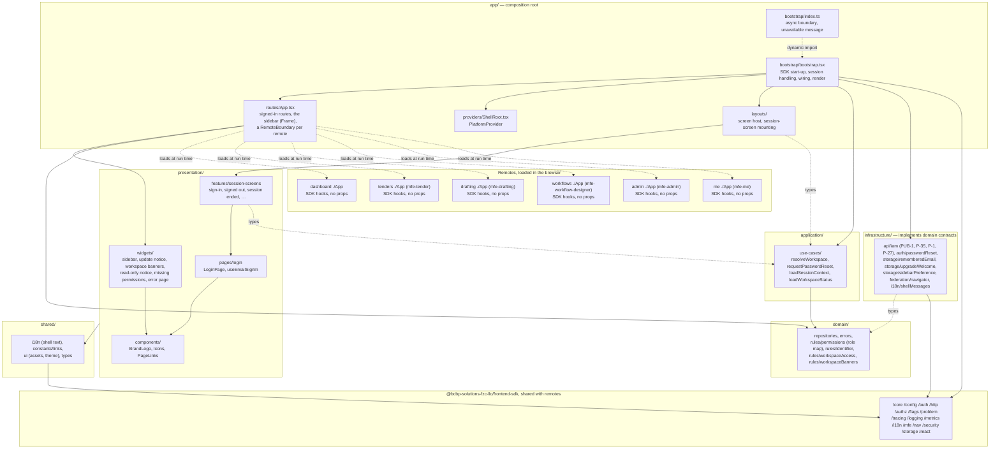
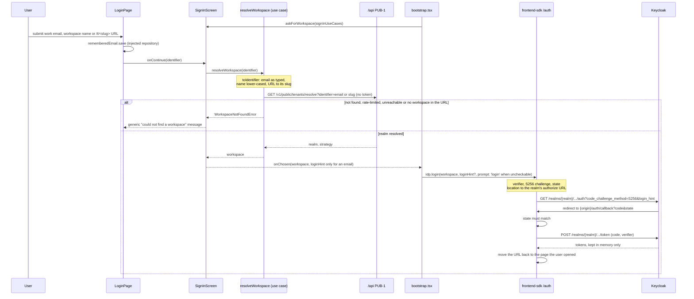
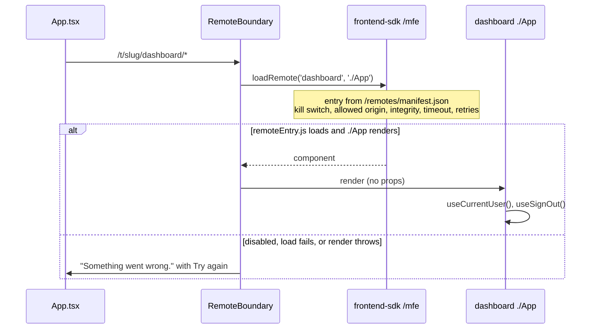
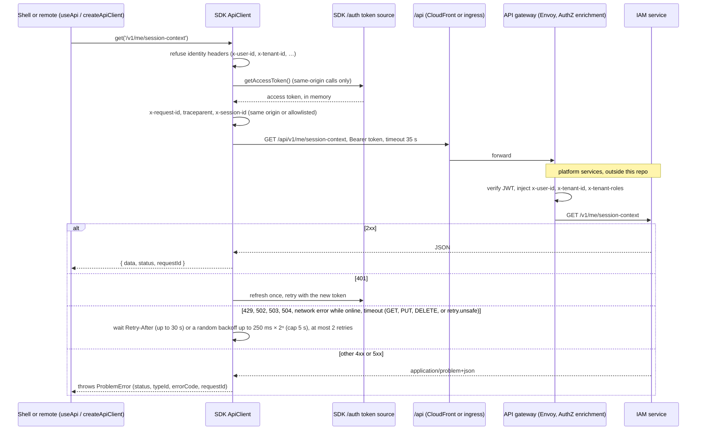
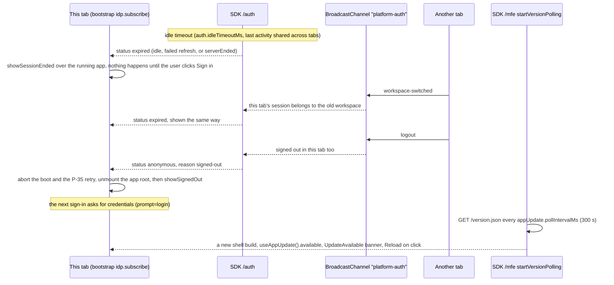
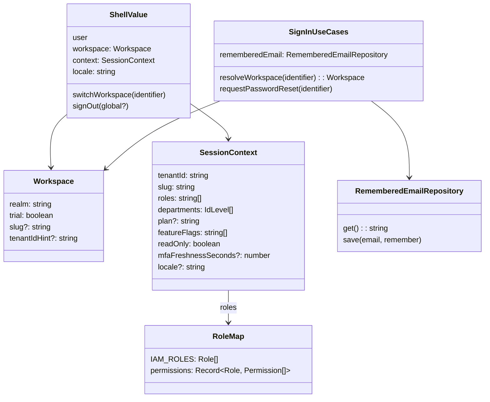
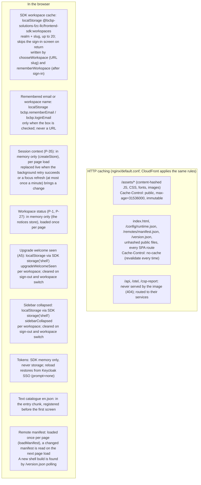
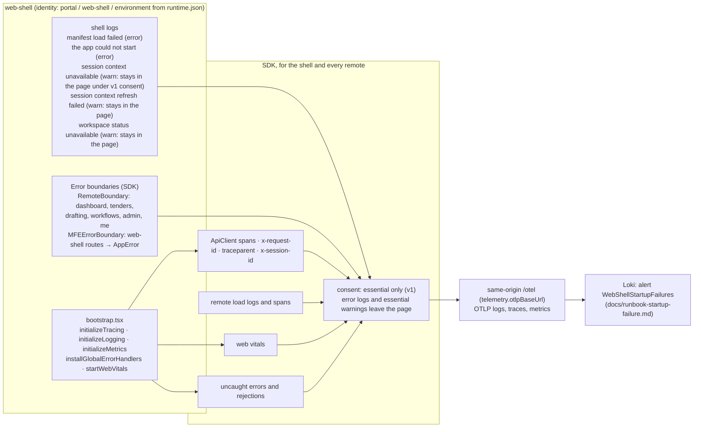

# Architecture

This document describes the internal structure, dependency direction, browser flows, data, caching, observability, security and deployment of `web-shell`.

`web-shell` is a **private Rsbuild application** (`github.com/BCBP-SOLUTIONS-FZC-LLC/web-shell`, Node.js 26, React 19.3) built on the platform SDK (`@bcbp-solutions-fzc-llc/frontend-sdk` `1.0.0-alpha.10`). The npm package name is `web-shell` and `"private": true`. Nothing installs it. What ships is a static bundle: the SDK bootstrap, the sign-in and session screens, and a Module Federation host (`shell`) that renders the `dashboard`, `tenders`, `drafting`, `workflows`, `admin` and `me` remotes beside its sidebar. The production process is nginx on port **8080**, uid **101**. There is no API server, database, or message bus in this repository.

Current release: `v0.5.0` (SDK alpha.10; the header, IAM's workspace screens, live roles; routes for six remotes); `v0.4.0` (remotes `dashboard` and `tenders`, SDK alpha.6) is its rollback; `v0.3.0`, `v0.2.0` and `v0.1.0` (remote `app2`) are superseded. `package.json` `version` matches the latest tag. Image tags, the SemVer contract, and how to cut a release are in [VERSIONING.md](./VERSIONING.md).

| This shell owns | Lives elsewhere |
|---|---|
| The SDK start-up sequence, the sign-in page (email, workspace name or URL), the session screens | Passwords, MFA, registration, token issuance (Keycloak). PKCE, token handling, refresh and idle timeout (the SDK's `/auth`) |
| The IAM ports: PUB-1 resolver, P-35 session context, and P-1/P-27 for the banners | The IAM APIs, tenant membership, authorization decisions (IAM services, the gateway) |
| Federation host `shell` and the shared map from `@bcbp-solutions-fzc-llc/webpack-preset` | Dashboard screens (`mfe-dashboard`, loaded as `dashboard`); tender screens (`mfe-tender`, loaded as `tenders`); drafting (`mfe-drafting`, `drafting`); the workflow designer (`mfe-workflow-designer`, `workflows`); administration (`mfe-admin`, `admin`) and the user's account (`mfe-me`, `me`), not built yet |
| The sidebar beside every remote (a drawer on a narrow screen): the BCBP mark, section links with icons to the served remotes, Admin (`manage:members`) with its sub-menu; a top bar with the sidebar's menu button, a notifications bell and the user's avatar (its menu: name and email, My account, Theme mode, Settings, Sign out) | Each remote's own section navigation |
| The shell value remotes read through SDK hooks (`user`, `signOut`, `workspace`, `context`, `refreshContext`) | Each environment's `/config/runtime.json` and `/remotes/manifest.json` (deploy pipeline, CloudFront) |
| `GET /healthz` and the static files nginx serves | Cluster rollout. A tag publishes an image. It does not deploy |

Only `__ENVIRONMENT__` and `__BUILD_VERSION__` are compiled into the bundle. Everything else is runtime configuration.

---

## Layer model

`src/` follows the Frontend Architecture Constitution's structure. Presentation → application → domain; infrastructure implements the domain's contracts; `app/` is the composition root and the only place that knows every layer. Nothing in `src/` imports the bootstrap except the entry. Solid arrows are imports in the real direction, and `npm run arch-lint` checks every one of them; dashed arrows are type-only imports, the entry's dynamic import of the bootstrap (the async boundary), or, for the remote, a load at run time.

> Source: [`docs/architecture/mermaid/layer-model.mmd`](docs/architecture/mermaid/layer-model.mmd)



**Direction:** presentation never imports infrastructure, `app/` or the SDK (the session screens take `/auth` types only); it gets use cases, repositories and state as props from `app/`. `bootstrap.tsx` is the only module that wires the layers together and the only one that renders the app root. `App.tsx` reads session state through SDK hooks, and the banners from the bootstrap's `notices` store (a prop, read with `useSyncExternalStore`), and passes them to the widgets (the sidebar's user, workspace, sign-out and switch too); the remote reads its own through SDK hooks (`useCurrentUser`, `useSignOut`).

The SDK is imported through public subpaths only. `@bcbp-solutions-fzc-llc/eslint-plugin` fails a root import (`@bcbp-solutions-fzc-llc/frontend-sdk`) or a deep import, and `npm run lint` runs in `validate-quality`.

---

## Module dependency graph

Arrows are TypeScript imports under `src/`. Dashed, labelled arrows carry only what the label names (types, `en.json`, the `/problem` error classes) or are dynamic imports.

> Source: [`docs/architecture/mermaid/package-dependencies.mmd`](docs/architecture/mermaid/package-dependencies.mmd)

```mermaid
graph LR
    index(["app/bootstrap/index.ts"])
    boot(["app/bootstrap/bootstrap.tsx"])
    app(["app/routes/App.tsx"])
    root(["app/providers/ShellRoot.tsx"])
    host(["app/layouts/sessionScreens.tsx"])
    screen(["app/layouts/screen.tsx"])
    screens(["presentation/features/session-screens"])
    login(["presentation/pages/login\nLoginPage, useEmailSignIn"])
    widgets(["presentation/widgets"])
    comps(["presentation/components\nBrandLogo, Icons, PageLinks"])
    usecases(["application/use-cases\nresolveWorkspace, requestPasswordReset,\nloadSessionContext, loadWorkspaceStatus"])
    domain(["domain/\nRememberedEmailRepository, WorkspaceStatusSource, UpgradeWelcomeRepository,\nSidebarPreferenceRepository, WorkspaceNotFoundError, rules/permissions, rules/identifier,\nrules/workspaceAccess, rules/workspaceBanners"])
    iam(["infrastructure/api/iam.ts"])
    reset(["infrastructure/auth/passwordReset.ts"])
    remember(["infrastructure/storage/rememberedEmail.ts\n(localStorage)"])
    welcome(["infrastructure/storage/upgradeWelcome.ts\n(SDK storage)"])
    sidebarPref(["infrastructure/storage/sidebarPreference.ts\n(SDK storage)"])
    nav(["infrastructure/federation/navigator.ts"])
    msgs(["infrastructure/i18n/shellMessages.ts"])
    text(["shared/i18n\nshell namespace, en.json"])
    links(["shared/constants/links.ts"])
    sdk(["frontend-sdk subpaths"])

    index -. dynamic import .-> boot
    index -. en.json .-> text
    boot --> app
    boot --> root
    boot --> host
    boot --> screen
    boot --> usecases
    boot --> domain
    boot --> iam
    boot --> reset
    boot --> remember
    boot --> welcome
    boot --> sidebarPref
    boot --> nav
    boot --> msgs
    boot --> sdk
    root -. types .-> usecases
    root --> sdk
    host --> screens
    host -. types .-> usecases
    host -. types .-> text
    host -. /auth types .-> sdk
    host --> screen
    screens --> login
    screens -. types, signIn.ts .-> usecases
    screens --> domain
    screens --> text
    login --> comps
    login --> domain
    login --> text
    comps --> links
    comps --> text
    links -. types .-> text
    app --> widgets
    app --> domain
    app --> text
    app --> sdk
    widgets --> text
    widgets --> comps
    usecases --> domain
    usecases -. types, /problem .-> sdk
    remember --> domain
    welcome -. types .-> domain
    welcome --> sdk
    sidebarPref -. types .-> domain
    sidebarPref --> sdk
    iam -. types .-> domain
    iam --> sdk
    reset --> sdk
    msgs --> text
    msgs --> sdk
    text --> sdk
```

`App.tsx` renders `dashboard`, `tenders`, `drafting`, `workflows`, `admin` and `me` through `RemoteBoundary`. That edge is not a file in this repo.

| Module | May import |
|---|---|
| `domain/` (contracts, errors, `rules/permissions.ts`, `rules/identifier.ts`, `rules/workspaceAccess.ts`, `rules/workspaceBanners.ts`) | Nothing but SDK types |
| `application/` (use cases) | `domain/`, SDK types and the `/problem` error classes. No React, no browser APIs (ports injected) |
| `infrastructure/` | `domain/`, `shared/i18n`, SDK subpaths. `storage/rememberedEmail.ts` implements `RememberedEmailRepository` over `localStorage`; `storage/upgradeWelcome.ts` implements `UpgradeWelcomeRepository` and `storage/sidebarPreference.ts` `SidebarPreferenceRepository` over the SDK's `storage('shell')`; `api/iam.ts` implements `WorkspaceStatusSource` (P-1, P-27); `i18n/shellMessages.ts` (`registerNamespace` + `setLocale`) changes the page's locale, so only the bootstrap calls it |
| `presentation/pages` | `components`, `domain/`, `application/` types, `shared/` (their words from `shared/i18n`). Never `infrastructure/`, `app/`, the SDK, `application/` values, storage, the network or navigation: the repository, use cases and state come in as props |
| `presentation/components` | `shared/` (`ui`, `i18n`, `constants`) |
| `presentation/widgets` | `shared/i18n`, `components` (`AppSidebar` draws `Icons`); state and actions are props |
| `presentation/features/session-screens` | `pages`, `components`, `domain/`, `application/` types, `shared/i18n`, SDK `/auth` types. The screens call the use cases they are given; every failure becomes catalogue words |
| `shared/i18n` | SDK `/i18n` (`t`, `formatDate`) and `/react` (`useT`), no shell layer: `en.json`, `catalogues.ts`, `useShellText`, `shellText`, `shellDate`, `ShellKey`. Text lookup and date formatting only: presentation reaches the SDK's i18n runtime through it and nothing else |
| `shared/constants` | `shared/i18n` (link labels are keys) |
| `shared/ui`, `shared/types` | Nothing (assets, styles, ambient types) |
| `app/layouts/` | `screen.tsx`: `react-dom/client`. `sessionScreens.tsx`: the session-screen components, the screen host, `shared/i18n` types (`ShellKey`), `application/` and SDK `/auth` types |
| `app/providers/ShellRoot.tsx` | React, SDK `/react`, the session-context store (`application/`) |
| `app/routes/App.tsx` | `react-router-dom`, `shared/i18n`, the widgets, `domain/rules/permissions` (`ADMIN_ENTRY`) and the `SidebarPreferenceRepository` type (the `sidebar` prop, from the bootstrap), SDK `/react` (`RemoteBoundary`, `MFEErrorBoundary`, `useRouteTemplate`, `useSessionContext`, `useAppUpdate`, `useReadOnly`, `useFeatureFlag`, and for the sidebar `useCurrentUser`, `useWorkspace`, `useSignOut`, `useSwitchWorkspace`, `useHasPermission`). It hands the router's `navigate` to the bootstrap through `onRouter` instead of importing `/nav`. The `notices` prop is the bootstrap's store of banners, the read-only date and the workspace's name; `remotes` is the set of served remotes the sidebar links to |
| `app/bootstrap/bootstrap.tsx` | Every layer except presentation and `shared/constants`, which it reaches through `layouts`, `providers` and `routes` (the composition root; the only module that imports `infrastructure/`: builds the use cases from infrastructure), every SDK subpath it initialises, `shared/ui/index.css` |
| `app/bootstrap/index.ts` | `bootstrap.tsx`, dynamically; `shared/i18n/en.json` statically (the unavailable page cannot use the SDK) |
| `rsbuild.config.ts` | The platform plugin, React, Tailwind, `/version.json`, `config/dev-platform.mjs`. `src/` does not import it |
| Tests | Production modules. `test/integration` replaces SDK subpaths with `vi.mock` fakes; `test/e2e` uses the real SDK with `test/fixtures/` fakes around it |

These rules are enforced twice. `eslint.config.js` (`@typescript-eslint/no-restricted-imports`, `no-restricted-globals`, `no-restricted-properties`; `test/unit/layer-rules.test.ts`) gives editor feedback and covers browser globals: presentation may not use `fetch`, `XMLHttpRequest`, storage, IndexedDB, `location`, `history`, `navigator` or `open`, bare or through `window`, `globalThis`, `self` (and `document.location`); domain and application may not use any browser global. `.dependency-cruiser.cjs` declares every component and its allowed dependencies, and `npm run arch-lint` fails an undeclared dependency, a file in no component, a cycle or an unresolvable import (`test/unit/arch-lint.test.ts`). `app/` has no ESLint layer rule; arch-lint limits `routes`, `providers` and `layouts` to what they render or provide, and only `bootstrap.tsx` may import `infrastructure/`.

---

## Bootstrap flow

`src/app/bootstrap/index.ts` imports `bootstrap.tsx` dynamically: Module Federation needs an async boundary before a shared module is used. The bootstrap runs once per page load, in the SDK's order (SDK design doc §C2).

> Source: [`docs/architecture/mermaid/bootstrap-flow.mmd`](docs/architecture/mermaid/bootstrap-flow.mmd)

```mermaid
sequenceDiagram
    participant Browser
    participant Index as index.ts
    participant Boot as bootstrap.tsx
    participant SDK as frontend-sdk
    participant IAM as /api (IAM)
    participant Screens as session screens (app/layouts)

    Browser->>Index: load document
    Index->>Boot: import('./bootstrap'), bootstrap()
    Boot->>SDK: installTrustedTypesPolicy, loadRuntimeConfig (/config/runtime.json)
    Boot->>SDK: initializeCore (environment from runtime.json, else build-time), setRuntimeConfig
    Note over Boot,SDK: a failure is logged as an error (default /otel), then "The app is unavailable right now."
    Boot->>SDK: tracing, logging, metrics, error handlers, web vitals (consent: SDK default, essential only)
    Boot->>SDK: registerShellMessages: registerNamespace('shell'), setLocale(defaultLocale), before any screen
    Boot->>SDK: createOidcProvider, initializeAuth, setTokenSource
    Boot->>SDK: idp.init()
    alt anonymous
        alt signed-out
            Boot->>Screens: showSignedOut (wait for a click)
        else device-clock
            Boot->>Screens: showDeviceClock (wait for a click)
        else none or login-required
            Boot->>SDK: workspace from the failed attempt (login-required; without one, ask), else chooseWorkspace
            opt no known workspace
                Boot->>Screens: askForWorkspace (email, name or URL → PUB-1)
            end
            Boot->>SDK: idp.login(workspace, loginHint?, prompt: 'login' when uncheckable)
        end
    else authenticated, wrong workspace
        Boot->>Screens: showWrongWorkspace (app never renders)
    else authenticated
        Boot->>SDK: idp.subscribe (expired, signed out), authorizer (role map)
        Boot->>IAM: GET /v1/me/session-context
        opt membership refused (access paused, not a member)
            Boot->>IAM: ask once more after 5 s (IAM's caches may lag a change)
        end
        opt trial workspace with a slug, no context yet, any failure but a workspace state
            Boot->>IAM: retry after 1 s, 2 s, 4 s before anything mounts
        end
        alt P-35 refuses the workspace (trial ended, suspended, access paused, not a member)
            Boot->>Screens: showWorkspaceUnavailable (A6/A8; app never renders, the shell remembers nothing)
        else trial with a slug, still no context
            Boot->>Screens: showWorkspaceLoadFailed (sign out, switch or try again; app never renders)
        else trial with a slug, P-35 slug is another tenant's
            Boot->>Screens: showWrongWorkspace (nothing cached, URL kept, app never renders)
        else
            Boot->>SDK: subject, flags, rememberWorkspace (/t/slug/)
            Boot->>SDK: initializeI18n (detect: P-35 locale), loadManifest, startVersionPolling
            Boot->>Browser: render App inside ShellRoot (PlatformProvider), registerNavigator
            Boot->>IAM: once the context is known, in the background: GET /v1/tenants/:id (P-1), and /seat-usage (P-27) for owners and admins
            Boot->>Browser: banners and the read-only grace date into App
            Boot->>Screens: showUpgradeWelcome (A5) once after a recent upgrade, never after expiry or over another screen
            opt no session context
                Boot->>IAM: retry after 1 s, 2 s, 4 s (online network error, timeout, 429, 502-504; never a trial with a slug)
                Boot->>SDK: subject, flags, rememberWorkspace, and the provider updates live
                Boot->>Screens: a retry answering with a workspace state: unmount App, showWorkspaceUnavailable
            end
        end
    end
```

1. `installTrustedTypesPolicy()`, then `loadRuntimeConfig()` fetches `/config/runtime.json` and validates it.
2. `initializeCore({ serviceName: 'web-shell', domain: 'portal', environment: cfg.environment ?? __ENVIRONMENT__, buildVersion: __BUILD_VERSION__ })`, then `setRuntimeConfig(cfg)`: the deployed `/config/runtime.json` names its environment (`environment`, SDK alpha.6) and the page takes it from there, so one build serves every environment; until every deployed file has the key, the build-time `PLATFORM_ENVIRONMENT` fills in. When the config cannot be loaded, the identity takes the build-time environment so the failure can still be reported. A throw from here on is logged as an essential error (`the app could not start`; logging starts on the default `/otel` when the config never arrived), then reaches `index.ts`, which replaces `#app` with "The app is unavailable right now." (the one text read from `en.json` directly: it shows when the SDK may not have loaded, before the async boundary)
3. Consent stays the SDK's default (essential only), then tracing, logging and metrics against `telemetry.otlpBaseUrl`, `installGlobalErrorHandlers()`, `startWebVitals()`, platform flags from the runtime config. Then `registerShellMessages(cfg.i18n.defaultLocale)` (`infrastructure/i18n/shellMessages.ts`): the shell's `shell` namespace is registered and loaded for the default locale (`setLocale`), so the sign-in screens, which show before step 8, never show raw keys.
4. `createOidcProvider(cfg.auth, workspaceResolver)`, `setTokenSource(initializeAuth(idp))`, `idp.init()`. On a reload or a new tab `init()` may redirect once with `prompt=none` and never settle.
5. Anonymous: see the sign-in flow. The bootstrap returns without rendering the app.
6. Authenticated in the wrong workspace (a trial login through an invitation that landed in another tenant): `showWrongWorkspace`. The app never renders and the workspace is not cached. A trial workspace with a slug is also checked against P-35 (step 7): every trial tenant shares one realm, so a silent restore can ride another trial tenant's SSO session, and a cached entry has no `tenantIdHint` for `isWrongWorkspace`.
7. Authenticated: `idp.subscribe` handles expiry and sign-out (below). When P-35 refuses the workspace itself (`blockedWorkspace`, LLD §7.1: `TENANT_TRIAL_EXPIRED` → "Your trial has ended" (A6); `TENANT_SUSPENDED` or `404 TENANT_NOT_FOUND` → "Workspace unavailable"; `MEMBER_SUSPENDED` or the gateway's `DENY_MEMBER_SUSPENDED` → "Your access is paused"; `DENY_UNRESOLVABLE_SUBJECT` or `404 MEMBER_NOT_FOUND` → "You don't have access to this workspace" (A8)), `showWorkspaceUnavailable` offers Sign out and Switch workspace and the app never renders. A membership refusal (the last two) is asked once more after 5 s first (`settleRefusal`), because IAM's caches can lag a reactivation or a new member by a few seconds. The shell remembers nothing (no `rememberWorkspace`, no `/t/<slug>/` move); a workspace the SDK's `chooseWorkspace` cached before login stays cached, so a reload restores into the same screen. Any other refusal (`INSUFFICIENT_ROLE` included) keeps the deny-all path below, and a background retry that answers with a workspace state is settled the same way (a membership refusal asked once more after 5 s, the deny-all app kept meanwhile) before it unmounts the app and shows that screen. Otherwise the P-35 session context sets the authorizer subject and tenant flags, and `rememberWorkspace` caches the workspace with its slug and moves the URL to `/t/<slug>/`. A trial workspace with a slug waits for P-35 before anything renders: every failure that is not a workspace state (offline, 404, 500 too) is retried first, no context shows "We couldn't load your workspace" (`showWorkspaceLoadFailed`), and a P-35 `slug` other than the workspace's shows `showWrongWorkspace`. Without a context (other sessions): deny-all and platform flags only, with a warning log; after render a network failure while online, a timeout, 429, 502, 503 or 504 (the SDK ApiClient's own rule) is retried after 1 s, 2 s and 4 s, one request per attempt, and a success updates the subject, flags and provider without a reload. A sign-out stops the retries, and a sign-out or an expiry during these steps stops the boot before the app mounts (`stopped()`).
8. `initializeI18n` (the user's P-35 `locale` first, through `detect`), `loadManifest()` (a failure is logged; the app still renders), `startVersionPolling()`.
9. Render `<App>` inside `app/providers/ShellRoot` (a `PlatformProvider` whose `context` follows the retry store and whose `locale` follows `setLocale`) into `#app`. The router's basename is `/t/<slug>` when `slugFromPath` finds one in the URL. The router is registered as the SDK's navigator: a remote's `navigate()` under the basename stays in the page; any other path is a full load. The path decides (`appId` is ignored). A `navigate()` that stays in the section the shell's routes show and changes the path or query remounts the routes, so that remote's own router starts at the new URL (it does not see the shell's navigation); one that changes nothing remounts nothing.
10. Once the session context is known (at render, or when the background retry or a focus refresh succeeds), P-1 and, for owners and tenant admins, P-27 load in the background (`loadWorkspaceStatus`): the banners, the read-only grace date and the workspace's name go into the `notices` store `App` reads, and a trial converted in the last 7 days shows the A5 welcome once per device, never after the session expired or over another screen. A failure logs `workspace status unavailable` and shows nothing.
11. After render, the page asks P-35 again when it gets focus (or its tab becomes visible), at most once a minute: a changed context is applied without a reload (a role given or removed elsewhere reaches the remotes' hints), a refusal or another workspace's context replaces the app with its screen, and a failure keeps the context (LLD §6.6e).

After render the subscription does two things:

| Session event | What the shell does |
|---|---|
| `expired` | "Session ended" dialog over the app. Sign in calls `signInAgain`, which re-resolves the workspace when the server ended the session and reuses the cache otherwise; its `prompt` callback (SDK alpha.9) asks for credentials for a trial workspace nothing can check |
| `anonymous`, `signed-out` (here or in another tab) | Unmount the app, so the previous user's data is not left under the dialog. "You are signed out"; Sign in calls `idp.login({ workspace })`, and the SDK adds `prompt=login` because it recorded the sign-out |

Routes inside the app:

| Path (under the basename) | Element |
|---|---|
| `/dashboard/*` | `RemoteBoundary` for `dashboard` `./App` |
| `/tenders/*` | `RemoteBoundary` for `tenders` `./App` (mfe-tender) |
| `/drafting/*` | `RemoteBoundary` for `drafting` `./App` (mfe-drafting) |
| `/workflows/*` | `RemoteBoundary` for `workflows` `./App` (mfe-workflow-designer) |
| `/admin/*` | `RemoteBoundary` for `admin` `./App` (mfe-admin) |
| `/me/*` | `RemoteBoundary` for `me` `./App` (mfe-me) |
| anything else | `<Navigate to="/dashboard" replace>` |

---

## Sign-in flow

> Source: [`docs/architecture/mermaid/sign-in-flow.mmd`](docs/architecture/mermaid/sign-in-flow.mmd)



Which workspace a signed-out visit uses, in order:

1. The workspace a failed silent attempt named (`reason: 'login-required'`). The SDK re-checks a trial one with PUB-1 first (at most 5 s, then the saved entry). When PUB-1 no longer knows it, `login-required` comes without a workspace and the shell goes straight to the sign-in screen (step 3), with or without a slug in the URL: never another cached workspace (the SDK's `SessionState` contract). Step 2 is for the other reasons; step 3 is the fallback for all of them.
2. `chooseWorkspace`: the `/t/<slug>` in the URL (cached or resolved; a cached trial entry is re-checked with PUB-1; a cached paid entry is used once Keycloak serves its realm, else re-checked with PUB-1), otherwise the most recently cached workspace.
3. The sign-in screen (`askForWorkspace`). It takes a work email, a workspace name or a pasted workspace URL (`toIdentifier` reduces a URL to its `/t/<slug>`), resolves it through PUB-1 and returns the workspace, with `loginHint` only when the user typed an email.

A known workspace goes straight to Keycloak, with the remembered email as `login_hint` when there is one (a remembered workspace name is not sent). After `reason: 'signed-out'` or `'device-clock'` the bootstrap shows a dialog and waits for a click: an automatic login after a logout would ride the live SSO session and undo it. A trial workspace with neither a slug nor a `tenantIdHint` (an invitation email, if IAM drops `tenant_id`: OQ-10) signs in with `prompt: 'login'`: nothing can check that session after sign-in, and the shared trial realm's SSO session may be someone else's.

PUB-1 → `Workspace`: strategy `shared` is the trial realm, with `tenant_id` as `tenantIdHint` and a slug only when the identifier was one. A dedicated realm's slug is the realm after `auth.paidRealmPrefix` (`tenant-`). The SDK refuses to cache a workspace whose slug and realm disagree, so a paid realm must be named `tenant-<slug>`; the local realm is `tenant-bcbp` for that reason.

The redirect URI is `{origin}{auth.redirectPath}` (`/auth/callback`). The local realm allows `http://localhost:5001/*` and `http://127.0.0.1:5001/*`. PKCE, `state`, the token exchange, refresh, the idle timeout and the cross-tab broadcast are the SDK's (`/auth`); this repo does not implement any of them.

"Not found", a 429, an unreachable resolver and a pasted URL that names no workspace all show one message ("We couldn't find a workspace for that. Try your workspace name — it's the part after /t/ in your workspace link — or ask your administrator."), so the screen never says which input failed.

**Forgot your password?** needs the typed email or workspace name (or a pasted URL): the realm decides where the reset happens. The screen resolves it through PUB-1 (same generic message on failure) and sends the browser to `{auth.idpOrigin}/realms/{realm}/login-actions/reset-credentials?client_id={auth.clientId}` (`infrastructure/auth/passwordReset.ts`); Keycloak e-mails the reset link. With an empty field the page asks for one first. The SDK has no reset helper, so this is the shell's.

**Help and legal links** (`shared/constants/links.ts`) render only when their URL is set, so the page has no dead links; none is published yet.

---

## Dashboard load

> Source: [`docs/architecture/mermaid/dashboard-load.mmd`](docs/architecture/mermaid/dashboard-load.mmd)



The shell passes no props. `dashboard` reads the user with `useCurrentUser()` and signs out with `useSignOut()` (global by default: the Keycloak session ends too, and every tab follows), from the shell value `PlatformProvider` holds.

`loadRemote` reads the entry from the manifest the bootstrap loaded, checks the kill switch (`remotes.killSwitch`, flag `remote.dashboard.disabled`) and the entry origin (the page's, or `remotes.allowedOrigins`), injects `remoteEntry.js` as a classic script with its `integrity`, and reads the container from `window.__platform_mfe_dashboard` (`__platform_mfe_<name>` since alpha.4). A remote must therefore be built with `@bcbp-solutions-fzc-llc/webpack-preset` (`role: 'remote'`, library type `var`; webpack, Rspack or Rsbuild). The share scope gives it this shell's React, OTel API and SDK; a remote built against a newer SDK than the shell's is refused at share negotiation, inside the boundary. "Try again" creates a new lazy import.

`/t/<slug>/tenders/*` loads `tenders` (mfe-tender) the same way: container `__platform_mfe_tenders`, flag `remote.tenders.disabled`, no props. react-router-dom is not shared, so the remote runs its own router under the shell's basename (LLD §15 #18). `/t/<slug>/drafting/*` (`drafting`, mfe-drafting) and `/t/<slug>/workflows/*` (`workflows`, mfe-workflow-designer) load the same way: containers `__platform_mfe_drafting` and `__platform_mfe_workflows`, flags `remote.drafting.disabled` and `remote.workflows.disabled`, no props, their own routers (LLD §15 #22). `/t/<slug>/admin/*` (`admin`, mfe-admin) and `/t/<slug>/me/*` (`me`, mfe-me) too: containers `__platform_mfe_admin` and `__platform_mfe_me`, flags `remote.admin.disabled` and `remote.me.disabled` (LLD §15 #23).

**The sidebar** (`Frame` in `App.tsx`, `presentation/widgets/AppSidebar.tsx`; LLD §6.6d) sits beside the routes on a wide screen (`sticky top-0`, the window's full height; the page is a `flex` row) and is a drawer opened from a bar at the top on a narrow one. It publishes `--shell-sidebar-width` (its width beside the page, `0px` as a drawer) and `--shell-header-height` (the bar's height, `0px` on a wide screen). It shows the BCBP mark, then under MENU links with icons to Dashboard, Tenders, Drafting and Workflows when the manifest lists the remote and it is not switched off (the bootstrap passes `remotes`: the manifest's keys less `isRemoteKilled`, worked out on every render, so a tenant flag from a late context hides a link), and Admin in the same list for `useHasPermission('manage', 'members')` with `admin` served: Admin opens and closes its sub-menu, a page opens from a sub-item. My account, the user (`useCurrentUser`) and Sign out (`useSignOut`) are in the user's menu in `AppTopBar`, the bar across the top of the page on a wide screen, beside the button that hides the sidebar completely. A link is followed by the shell's router, without a page load; a link to the section the user is in remounts the routes, because the remote's own router does not see the shell's navigation. Flag `shell.frame: false` turns the sidebar off.

---

## API request flow

Every call to `/api`, from the shell or from a remote, goes through the SDK's `ApiClient` (`createApiClient`, or `useApi` in a remote). The shell never calls `fetch` itself (presentation is lint-blocked from it), and it never sets identity headers: the gateway derives them from the verified token.

> Source: [`docs/architecture/mermaid/api-request-flow.mmd`](docs/architecture/mermaid/api-request-flow.mmd)



| Concern | Behaviour (SDK `ApiClient`, alpha.9) |
|---|---|
| Token | `Authorization: Bearer` only to the page's own origin, from the in-memory token source (`setTokenSource(initializeAuth(idp))`); `auth: false` sends none (PUB-1) |
| Identity headers | `x-user-id`, `x-tenant-id`, `x-tenant-roles`, `x-departments`, `x-plan`, `x-feature-flags`, `x-residency-mode`, `x-auth-time` (alpha.7) are refused: a `TypeError` in `local`, `dev` or before an environment is identified, dropped with an essential warning elsewhere |
| Correlation | `x-request-id` (per call), W3C `traceparent`, and `x-session-id` (unless `telemetry.sendSessionHeader` is false), on same-origin or `api.propagationAllowlist` URLs only |
| Timeout | `api.timeoutMs` (35 000 ms in the image's `runtime.json`) → `TimeoutError` |
| Retries | GET, PUT and DELETE (POST and PATCH only with `retry.unsafe`): up to 2 by default, on 429, 502, 503, 504, a network error while online, or a timeout. Waits `Retry-After` (capped at 30 s), else a random wait up to 250 ms × 2ⁿ, capped at 5 s. `isTransient` in `application/use-cases/loadSessionContext.ts` mirrors this rule; a test fails if they diverge |
| 401 | One token refresh and a retry; then the token source's `onUnauthorized` |
| Errors | `application/problem+json` → `ProblemError` (`status`, `typeId`, `errorCode`, `requestId`); offline → `NetworkError(offline)`. The shell shows catalogue words, never a server's message |
| Redirects | Not followed when the request carries a token or correlation headers; an opaque or 3xx answer becomes a 502 problem |

---

## Pre-login workspace resolution (PUB-1)

Before sign-in the browser has no token and no realm. PUB-1 answers one question for it: which Keycloak realm the sign-in redirect goes to.

- **Only when needed.** The bootstrap first asks the SDK's `chooseWorkspace`. A cached paid workspace (`localStorage` `…:workspaces`: the URL's `/t/<slug>/`, or with no slug the most recent) skips the sign-in screen, and PUB-1 too once Keycloak serves its realm's discovery document (≤ 3 s; SDK alpha.9); a realm deleted under it (a revert, offboarding) is re-checked with PUB-1; an uncached slug in the URL is resolved through PUB-1 without the sign-in screen. A cached trial entry is re-checked with PUB-1 (at most 5 s; one call per trial sign-in). A failed silent sign-in names its own workspace, or none when PUB-1 no longer knows it.
- **No token.** `GET /api/v1/public/tenants/resolve?identifier=<email or slug>` with `auth: false`; PUB-1 is public and rate-limited per IP.
- **Mapping (`toWorkspace`).** `strategy: "shared"` is the trial realm, and the slug is known only when the identifier was the slug (kept trimmed and lower-cased; `toSessionContext` does the same to P-35's `slug`, so the trial slug check compares like with like). `tenant_id` becomes `tenantIdHint`. `"dedicated"` is a paid realm: the slug is the realm without `auth.paidRealmPrefix` (`tenant-`). `found: false`, or a missing realm, is no workspace.
- **One message for every failure.** `resolveWorkspaceUseCase` turns not found, 429, unreachable, malformed and a URL with no workspace alike into `WorkspaceNotFoundError`; the screen shows "We couldn't find a workspace for that. Try your workspace name — it's the part after /t/ in your workspace link — or ask your administrator." It never says which input failed (email, workspace name or URL).
- **No shell cache, no retry loop.** One request per submit; the ApiClient's own retries apply to 429 and 502–504. An email or workspace name resolved on the sign-in screen is cached only after a successful sign-in (`rememberWorkspace`, with the slug from P-35). A slug from the URL that PUB-1 resolves is cached by `chooseWorkspace` at once, after the SDK checks that realm and slug match.

> Source: [`docs/architecture/mermaid/pub1-resolution-flow.mmd`](docs/architecture/mermaid/pub1-resolution-flow.mmd)

```mermaid
sequenceDiagram
    participant Boot as bootstrap.tsx
    participant SDK as SDK /auth (chooseWorkspace)
    participant Cache as localStorage workspaces (SDK)
    participant Screen as Sign-in screen
    participant UC as resolveWorkspace (use case)
    participant Port as workspaceResolver (infrastructure/api/iam.ts)
    participant PUB as /api PUB-1

    Boot->>SDK: chooseWorkspace(pathname, resolver)
    alt URL has a workspace slug that is cached, or no slug and any workspace is cached
        SDK->>Cache: the slug's workspace, or the most recent one
        Cache-->>Boot: Workspace (paid: realm confirmed with Keycloak discovery, PUB-1 only if it is gone; trial: re-checked with PUB-1, ≤ 5 s)
    else URL has a workspace slug that is not cached
        SDK->>PUB: resolve(slug) through workspaceResolver
        PUB-->>SDK: realm
        SDK->>Cache: write it at once (realm and slug must match)
        SDK-->>Boot: Workspace (or none: ask on the sign-in screen)
    else no slug and nothing cached
        Boot->>Screen: askForWorkspace(signInUseCases)
        loop until a workspace is found
            Screen->>UC: resolveWorkspace(identifier)
            Note over UC: toIdentifier: email, name lower-cased, URL to its slug<br/>no workspace in a URL: no PUB-1 call, not found
            UC->>Port: resolve(email or slug)
            Port->>PUB: GET /api/v1/public/tenants/resolve?identifier= (auth false, no token)
            PUB-->>Port: 200 found, realm, strategy, tenant_id
            Port->>Port: toWorkspace (shared is the trial realm, dedicated is realm minus paidRealmPrefix)
            alt found
                UC-->>Screen: Workspace
            else not found, 429, unreachable, malformed, no workspace in the URL
                UC-->>Screen: WorkspaceNotFoundError
                Screen->>Screen: one generic message (the user can try again)
            end
        end
        Screen-->>Boot: Workspace, and loginHint only when an email was typed (onChosen)
    end
    Boot->>SDK: idp.login(workspace, loginHint?, prompt: 'login' when uncheckable)
    Note over SDK: after sign-in rememberWorkspace caches it with the slug from P-35
```

---

## Session context (P-35), roles and flags

Roles, plan and flags are not in the token. After sign-in the bootstrap loads them from IAM P-35 (`GET /api/v1/me/session-context`) and maps them with `toSessionContext` (snake_case to camelCase; missing lists become empty; `slug` trimmed and lower-cased).

| Step | What happens |
|---|---|
| Load | `sessionContextSource.load()`, with the ApiClient's own retries |
| Success | `setAuthzSubject({ roles, tenantId })`; `setFlagProvider(sessionContextFlagProvider(context))`; `rememberWorkspace({ …workspace, slug })` moves the URL under `/t/<slug>/`; the IAM `locale` feeds `initializeI18n` |
| Refused (workspace state) | `blockedWorkspace` (`domain/rules/workspaceAccess.ts`, LLD §7.1): trial ended, workspace suspended or closed, access paused, not a member → `showWorkspaceUnavailable` (Sign out, Switch workspace: the sign-in screen, then `switchWorkspace(w, { prompt: 'login' })`). A membership refusal is asked once more after 5 s. No subject, flags, `rememberWorkspace` or render |
| Any other failure (not a trial with a slug: see that row) | Warning `session context unavailable`; the authorizer denies all and only platform flags apply; `App` shows the missing-permissions notice with Reload, until a retry or a focus refresh answers |
| Read-only | `useReadOnly()` (P-35 `read_only`, or a `DENY_TENANT_READ_ONLY` answer seen on the page): `App` shows "Workspace is read-only (subscription ended)" (`ReadOnlyNotice`, IAM spec §7.10), stacked with the missing-permissions notice at the bottom (the stack is `sticky bottom-0` in the page's flow after the remote, so the page ends below it and never hides the remote's last controls). For a cancelled workspace P-1's `read_only_until` adds "Access ends on <date>" (the grace end, when the workspace is suspended). Remotes disable their own actions; the shell only says why |
| Trial with a slug | P-35 is awaited before anything mounts: every first failure that is not a workspace state (offline, 404, 500 and the transient ones) is tried 3 more times first (1 s, 2 s, 4 s; `retryable` on `retrySessionContext`). `showWorkspaceLoading()` ("Loading your workspace…", words only, nothing of the session) covers the wait; the next screen or the app replaces it. A workspace state from a retry is settled like the first load's (a membership refusal asked once more after 5 s; if that ask fails otherwise, the retries run once more) and shows its screen; no context after them shows "We couldn't load your workspace" (`showWorkspaceLoadFailed`: Sign out, Switch workspace (`prompt: 'login'`) and Try again (a reload, which may fail the same way)); a P-35 `slug` other than the workspace's shows the wrong-workspace screen. None of them renders the app or calls `rememberWorkspace`. A sign-out or an expiry ("Session ended") during the wait stops the boot. Known limit: a workspace state (A6/A8) carries no slug, so a foreign trial session that IAM refuses shows that state's screen, not the wrong-workspace one; nothing else of that tenant shows. Where P-35 is not deployed (404), a trial user with a slug gets the load-failed screen after about 7 s |
| Background retry | Never for a trial with a slug (above). Only after a transient failure (`isTransient`): 3 tries after 1 s, 2 s, 4 s, one request each (`loadSessionContextOnce`, `retry: false`). A success updates the subject, the flags and the `PlatformProvider` live, and re-renders the router if the URL moved. A sign-out aborts it, or an expiry discards its answer. A retry that answers with a workspace state (LLD §7.1) is settled like the first load's (`settleRefusal`: a membership refusal asked once more after 5 s; the deny-all app stays meanwhile, a context from that ask is applied, another failure keeps deny-all), then unmounts the app and shows that screen. |
| Focus refresh | After render, on `focus` or the tab becoming visible, at most once a minute, one request (`loadSessionContextOnce`). A changed context is applied like the background retry's; a workspace state or another workspace's context replaces the app with its screen; any other failure keeps the context (`session context refresh failed`). LLD §6.6e |
| Workspace banners | After render, once the context is known (the first load or a late one): P-1 `GET /api/v1/tenants/:id` and, for owners and tenant admins (`manage:members`), P-27 `…/seat-usage`, in the background (`loadWorkspaceStatus`). `workspaceBanners` (`domain/rules/workspaceBanners.ts`) picks trial days left, whole days to the nearest day, at least 1 (a new 14-day trial reads 14; "within a day" only in the last 24 h; "Your trial has ended" once the end has passed while IAM still says `trial`) (everyone), payment problem (owner, `manage:tenant-settings`), all seats used (owner and tenant admin, `manage:members`; `active_users + pending_invitations >= licensed_seats`, IAM has no overage), no owner (tenant admin); `App` shows them in the bottom stack (`WorkspaceBanners`). A failure logs `workspace status unavailable` and shows none. A trial converted to paid in the last 7 days and still on a paid plan (`active` or `past_due`, never `cancelled`) shows the welcome (A5) once per device and workspace (SDK `storage('shell')` key `upgradeWelcomeSeen`, cleared on sign-out), marked seen when shown so a screen that replaces it does not bring it back. A sign-out, an expiry or a refusal screen while P-1/P-27 load sets nothing (`stopped()`). The banners are worked out again every hour from the loaded answers (`BANNER_REFRESH_MS`, no new request), so the trial's days left move in an open tab; a sign-out or an expiry stops it |
| Role map | `domain/rules/permissions.ts`: keys are IAM's closed set (`member`, `tenant_owner`, `tenant_admin`, `tender_admin`); `roleMapAuthorizer` turns roles into `action:resource` UI permissions (one colon each, or it throws), including the IAM screens' `manage:admin-roles`, `manage:tenant-settings` (owner), `manage:sso`, `manage:delegation-policy`, `read:audit` (admin) and `manage:tender-access` (tender admin). Department levels are never roles. UI hints only: the services enforce |

---

## Session events and cross-tab sync

After render the bootstrap reacts to the SDK's session events through `idp.subscribe`. None of them signs in without a click.

> Source: [`docs/architecture/mermaid/session-events.mmd`](docs/architecture/mermaid/session-events.mmd)



| Event | Source | The shell's reaction |
|---|---|---|
| `expired` (idle, a failed refresh, ended at the server: `serverEnded`, or a workspace switch in another tab) | SDK `/auth`: the idle timer (`auth.idleTimeoutMs`, last activity shared across tabs), the token refresh, or `workspace-switched` on `platform-auth` | `showSessionEnded`: "Session ended" with Sign in, over the running app; `signInAgain` runs only on the click. During start-up it also stops the boot (`stopped()`). Not shown while a refusal screen (A6/A8, wrong workspace, workspace not loaded) is up: that screen stays, since "Session ended" would sign in to the same, possibly foreign, session, and its own Sign out and Switch ask for credentials |
| `anonymous`, reason `signed-out` | Sign-out here or in another tab (`BroadcastChannel` `platform-auth`) | Abort the boot and the P-35 retry, unmount `#app`, then "You are signed out". The next sign-in sends `prompt=login` |
| New shell build | `startVersionPolling` (`/version.json` holds the shell's build version; every `appUpdate.pollIntervalMs`, 300 s) | `UpdateAvailable` banner; reload only on the user's click. A new dashboard (a changed manifest only) is picked up on the next page load |
| P-35 recovered | The background retry | Permissions and flags appear without a reload |
| Window focus or the tab visible again, at least a minute after the last ask | The focus refresh (LLD §6.6e) | P-35 asked again; a changed context is applied without a reload; a refusal or another workspace's context replaces the app with its screen |

---

## Browser storage

Tokens are never written to storage. A reload restores the session from Keycloak's SSO cookie with `prompt=none`.

| Key | Store | Written by | Purpose |
|---|---|---|---|
| `@bcbp-solutions-fzc-llc/frontend-sdk:workspaces` | `localStorage` | SDK, `rememberWorkspace` | Cached workspaces (realm, slug), so a return visit skips the sign-in screen |
| `…:storage:<workspace>:shell:upgradeWelcomeSeen` | `localStorage` (SDK `storage('shell')`) | `infrastructure/storage/upgradeWelcome.ts` | The upgrade welcome (A5) was seen in this workspace on this device; the SDK clears it on sign-out and workspace switch |
| `…:storage:<workspace>:shell:sidebarCollapsed` | `localStorage` (SDK `storage('shell')`) | `infrastructure/storage/sidebarPreference.ts` | The sidebar is collapsed to its icon rail in this workspace on this device; the SDK clears it on sign-out and workspace switch |
| `@bcbp-solutions-fzc-llc/frontend-sdk:session-id`, `:auth:last-activity`, `:auth:last-user` | `localStorage` | SDK | Telemetry session id, idle timeout across tabs, user change detection |
| `bcbp.rememberEmail`, `bcbp.loginEmail` | `localStorage` | `infrastructure/storage/rememberedEmail.ts` (behind the domain's `RememberedEmailRepository`) | "Remember Email" only: an email or a bare workspace name only, never a URL (a pasted link may carry a token or code; `isRememberableIdentifier`). With the box checked, a value that cannot be remembered (a URL, an over-long value) clears both keys, as unchecked does: a kept email would become the next person's `login_hint` on a shared device. Needed before a workspace is known, so it does not use the SDK's per-workspace `storage()`. Every access is wrapped in `try`; blocked storage just forgets |

Remotes that need storage use `storage(appId)` from `/storage`, which is namespaced per workspace and refuses token-like keys.

---

## Data model

The shell has no database. Its data is a few contracts: what IAM returns, what the SDK keeps, and what remotes read. Field names are the code's (`infrastructure/api/iam.ts`, SDK `/auth` types, `domain/`).

> Source: [`docs/architecture/mermaid/data-model.mmd`](docs/architecture/mermaid/data-model.mmd)



| Contract | Shape | Owner |
|---|---|---|
| PUB-1 response | `{ found, realm, strategy: shared or dedicated, tenant_id? }` | IAM (public) |
| P-35 response | `{ tenant_id, slug, roles, departments, plan, feature_flags, read_only, mfa_freshness_seconds, locale }` | IAM |
| `Workspace` | `realm`, `trial`, `slug?`, `tenantIdHint?` | SDK `/auth`; mapped by `toWorkspace` |
| P-35 refusal | Problem `status` + `errorCode` (`TENANT_TRIAL_EXPIRED`, `TENANT_SUSPENDED`, `TENANT_NOT_FOUND`, `MEMBER_SUSPENDED`, `DENY_MEMBER_SUSPENDED`, `DENY_UNRESOLVABLE_SUBJECT`, `MEMBER_NOT_FOUND`) → `WorkspaceBlock` | IAM (Org & Membership, gateway); mapped by `workspaceBlock` |
| `SessionContext` | `tenantId`, `slug`, `roles`, `departments` (`{ id, level }[]`, drawn as `IdLevel[]`), `plan?`, `featureFlags`, `readOnly`, `mfaFreshnessSeconds?`, `locale?` | SDK `/auth`; mapped by `toSessionContext` |
| `TenantStatus` (P-1) | `name`, `status`, `trialEndsAt?`, `subscriptionStartedAt?`, `ownerlessSince?`, `readOnlyUntil?` | IAM Org & Membership; mapped by `toTenantStatus` |
| `SeatUsage` (P-27) | `activeUsers`, `pendingInvitations`, `licensedSeats` | IAM Org & Membership; mapped by `toSeatUsage` |
| Shell value | `user`, `workspace`, `context`, `locale`, `switchWorkspace`, `signOut` | This shell, in `PlatformProvider`; remotes read it through SDK hooks (no props) |
| `--shell-notices-height` | The bottom notice stack's height in px on `<html>` (`NOTICES_HEIGHT_VAR`, `routes/App.tsx`), `0px` when empty | This shell (`NoticeStack`, `ResizeObserver`, set through the CSSOM); a remote's fixed elements may read it (optional) |
| `--shell-sidebar-width`, `--shell-header-height` | The sidebar's width beside the page (`0px` while it is a drawer) and the narrow-screen bar's height (`0px` on a wide screen), in px on `<html>` (`SIDEBAR_WIDTH_VAR`, `HEADER_HEIGHT_VAR`, `routes/App.tsx`); absent while the frame is off | This shell (`usePublishedSize`: `ResizeObserver`, window resizes, the CSSOM); a remote's fixed elements may read them (optional) |
| Runtime config | `/config/runtime.json`, validated strictly by the SDK (README § Configuration, LLD §9.1) | Each environment |
| Remote manifest | `/remotes/manifest.json`: `dashboard`, `tenders`, `drafting`, `workflows`, `admin`, `me` → entry URL and `integrity`. Its keys also decide the sidebar's links | Each environment |
| Storage keys | § Browser storage | SDK, `infrastructure/storage/rememberedEmail.ts`, `infrastructure/storage/upgradeWelcome.ts` and `infrastructure/storage/sidebarPreference.ts` |

---

## Cache strategy

Nothing the shell caches is a source of truth: every cache can be lost without breaking a flow, and tokens are never cached outside memory.

> Source: [`docs/architecture/mermaid/cache-strategy.mmd`](docs/architecture/mermaid/cache-strategy.mmd)



| What | Where | Lifetime | Invalidated by |
|---|---|---|---|
| Hashed assets | Browser and CDN | One year, `immutable` | A new build (new file names) |
| `index.html`, runtime config, manifest, `/version.json`, SPA routes | Browser and CDN | Revalidated every request (`no-cache`) | Each deployment |
| Workspaces (realm, slug) | `localStorage`, SDK | Up to 20, most recent first | `chooseWorkspace` (a URL slug resolved by PUB-1) and `rememberWorkspace` (after sign-in) replace the entry for a slug, and write only when slug and realm match; a wrong-workspace login is never cached |
| Remembered email | `localStorage` | Until unchecked | Unchecking "Remember Email" |
| Session context | Memory | The page | A reload, the background retry's success, or a changed answer to the focus refresh (at most once a minute) |
| Workspace status (P-1, P-27) | Memory | The page | A reload |
| Upgrade welcome seen (A5) | `localStorage` (SDK `storage('shell')`) | Per workspace, until sign-out | The SDK's `clearAllAppStorage` on sign-out and workspace switch |
| Sidebar collapsed | `localStorage` (SDK `storage('shell')`) | Per workspace, until sign-out | The SDK's `clearAllAppStorage` on sign-out and workspace switch |
| Tokens | Memory (SDK) | Until expiry or sign-out | Refresh, sign-out (all tabs) |

---

## Observability stack

The shell starts the SDK's telemetry once per page and emits only five log events of its own; everything else is the SDK's, for the shell and every remote alike. Details, tiers and the metric inventory: [docs/observability.md](docs/observability.md).

> Source: [`docs/architecture/mermaid/observability-stack.mmd`](docs/architecture/mermaid/observability-stack.mmd)



| Signal | Emitted by | Notes |
|---|---|---|
| Identity | `initializeCore` | `service` `web-shell`, `domain` `portal`, `environment` from `runtime.json` (else the build-time fallback), `buildVersion`; injected into every data point |
| Logs | SDK logger; five shell events (LLD §11) | `the app could not start` and `manifest load failed` are errors and leave the page; `session context unavailable`, `session context refresh failed` and `workspace status unavailable` are non-essential warnings and stay in the page under v1 consent. `the app could not start` is reported even when the config never loaded (default `/otel`) |
| Traces | `initializeTracing`; ApiClient and remote-load spans | `traceparent` on same-origin and allowlisted calls; `telemetry.sampleRatio` |
| Metrics | `initializeMetrics`; SDK Tier 1 `platform_web_*` (pending ratification) | The shell creates none (`npm run metrics-check`) |
| Errors | `installGlobalErrorHandlers`; `RemoteBoundary` (`dashboard`, `tenders`, `drafting`, `workflows`, `admin`, `me`); `MFEErrorBoundary` (`web-shell`) | A boundary logs `remote failed to render` (error) with its `mfe`; an API, timeout or network error is a non-essential warning (`remote showed an error`) that v1 consent keeps in the page. It reloads once on a chunk-load error, then shows its fallback |
| Consent | SDK default, essential only (v1) | Only error logs and essential warnings leave the page |
| Alert | `WebShellStartupFailures` (Loki, example rule) | [runbook](docs/runbook-startup-failure.md); must be deployed to the Loki ruler (LLD §15) |

---

## Content Security Policy and Trusted Types

The browser enforces the shell's security boundary: a strict CSP with Trusted Types. It is the defence that remains if a script ever runs in the page (§ Threat model).

| Layer | Where | What it enforces |
|---|---|---|
| Build | Rsbuild `inlineScripts`/`inlineStyles: false`; preset `ChunkIntegrityPlugin` | No inline code, so no `unsafe-inline`; every script carries `integrity` (sha384); HTML tags and cross-origin chunks carry `crossorigin="anonymous"` |
| Policy | CloudFront, or until then `nginx/security.d/csp.conf.example` mounted per environment (never both) | `default-src 'none'`; `script-src`, `style-src`, `font-src` `'self'`; `connect-src 'self'` + the IdP; `form-action 'self'` + the IdP (the global sign-out POSTs a form to Keycloak); `frame-ancestors 'none'`; `report-uri /csp-report` |
| Trusted Types | `require-trusted-types-for 'script'`; policies `platform-sdk`, `platform-webpack`, `dompurify` | `installTrustedTypesPolicy()` is the bootstrap's first call, so chunk loading and sanitised HTML go through named policies |
| Fonts and images | Self-hosted (`@fontsource-variable/*`), bundled under `/assets/` | No third-party origin in `index.html` or the CSP |
| Proof | `test/browser` (Playwright, three engines) | The production build runs under the production CSP; any CSP report fails the test. Smoke `live` checks the deployed header, including `form-action` |

---

## Concurrency and races

A browser shell has no locks, but it has races: an async start-up that a sign-out can interrupt, several tabs, and React's double effects in development.

| Race | Guard |
|---|---|
| Sign-out, or the session expires, while the bootstrap is still awaiting (P-35, i18n, manifest) | `stopped()` (`signedOutDuringBoot` (`AbortController`), `expired`, or `refused`: a refusal screen replaced the boot or the app, through `refuse()`): checked after every await, so the app never mounts for a user who is gone and "Session ended" is never covered |
| The session expires while a refusal screen is up (A6/A8, wrong workspace, workspace not loaded) | The refusal screen stays (`refused`); "Session ended" is not shown, since its Sign in would ride the same, possibly foreign, session. A sign-out still shows "You are signed out" |
| Sign-out during the P-35 background retry | The same signal aborts the retry's sleep and request; a late answer is discarded. An expiry lets the retry finish, but its answer is discarded too (`stopped()`) |
| A focus refresh and the background retry overlap | Every P-35 request after the first load is numbered; a context is applied only if no later request's answer has been, so an older read never undoes a newer one, whichever answers last. The retry also ends (its own abort signal: sleep, request and second ask) once a refresh applies a context or a refusal replaces the app |
| Focus events while a focus refresh runs, or a sign-out or expiry during one | One refresh at a time (later events are dropped, and the minute is counted from each ask). A sign-out aborts its request and removes the listeners; an answer after an expiry or a refusal screen is discarded (`stopped()`) |
| Sign-out while P-1/P-27 load | The same signal aborts the requests (nothing logged); `stopped()` (sign-out or expiry) is checked before the store is set; `noticesRequested` loads once per page |
| The session expires, or another screen opens, while P-1 loads | Expiry or a refusal screen: nothing is set (`stopped()`): no banners, no date, no A5, and the hourly banner refresh stops. Another screen up: A5 is skipped (`isScreenShown()`). "Session ended" or "Workspace not found" is never replaced |
| A remote calls `switchWorkspace` after a sign-out, an expiry or a refusal, or its PUB-1 answer arrives after one | `stopped()` checked before and after PUB-1: nothing is shown, so "Session ended" or the refusal screen stays |
| Another tab signs out | `BroadcastChannel` `platform-auth` (SDK) → `anonymous`, `signed-out`; the shell unmounts `#app` before "You are signed out" |
| The idle timer fires, or another tab switches workspace | Last activity is shared across tabs; `workspace-switched` on `platform-auth` (SDK) → `expired`: "Session ended" is shown over the app, and nothing signs in until the click |
| Overlapping `setLocale` calls (a language switch while a catalogue loads). The bootstrap's two calls cannot overlap: `registerShellMessages` is awaited before `initializeI18n` | The SDK's generation counter: the later call wins |
| The router's basename changes after the P-35 retry or a focus refresh moves the URL | `App` is keyed by the basename, so a new router mounts |
| React StrictMode runs effects twice | `registerNavigator` simply replaces the navigator; tests assert the double registration |
| Concurrent loads of one catalogue | The SDK shares one promise per namespace and locale |

---

## Failure domains

| Step | Dependency | Posture | On failure |
|---|---|---|---|
| Identity and runtime config | `/config/runtime.json` | stop | "The app is unavailable right now." with Try again. Logged as the essential error `the app could not start` (to the collector, default `/otel`); alert in [the runbook](docs/runbook-startup-failure.md) |
| Silent restore | Keycloak SSO session | degrade | `anonymous`; the sign-in flow runs |
| Resolve the email or workspace name | PUB-1 | stop on that screen | One generic message. The user can retry |
| Leave for Keycloak | Browser navigation | stop | The shell is gone until Keycloak redirects back |
| Session context, a workspace state | P-35 | stop on that screen | A6/A8 dialog with Sign out and Switch workspace; the app never renders (a membership refusal is asked once more after 5 s, on the first load, a trial's pre-render retries, the background retry and the focus refresh alike; a refusal that holds on a background retry or a focus refresh unmounts the app) |
| Session context, a trial with a slug that never loads | P-35 | stop on that screen | "We couldn't load your workspace" with Sign out, Switch workspace (`prompt: 'login'`) and Try again (a reload, which may fail the same way) after 3 retries of any failure that is not a workspace state (also offline, 404 and 500: where P-35 is not deployed, every trial user with a slug stops here); the app never renders, since the session may be another trial tenant's: without P-35 the slug cannot be checked, so `INSUFFICIENT_ROLE` keeps it closed too. The text says so ("…so it stays closed. Try again later, sign out, or switch to another workspace."). Every environment where trial users sign in must serve P-35: smoke `live` checks it (401 without a token, never 404) |
| Session context, any other failure (not a trial with a slug) | P-35 | degrade, then recover | Warning log. Deny-all permissions and platform flags until it answers; after a transient failure (a network failure while online, a timeout, 429, 502, 503 or 504 (the SDK ApiClient's own rule)) it is retried after 1 s, 2 s, 4 s, one request per attempt, and applied live (any other answer, offline included, is final for that retry; the focus refresh, LLD §6.6e, can still recover it) (the router moves under `/t/<slug>/` then). A notice with Reload says some actions are hidden |
| Workspace banners | P-1, P-27 | ignore | Warning log `workspace status unavailable`; no banners, no read-only date, no A5; the sidebar names the workspace by its slug. Not retried |
| Remote manifest | `/remotes/manifest.json` | degrade | Error log. The app renders; `RemoteBoundary` shows its error; the sidebar has no section links |
| A remote loads or renders (dashboard, tenders, drafting, workflows, admin, me) | That remote | degrade | Boundary message with "Try again". The rest of the shell keeps running |
| The shell's own screens render | `App.tsx` and its widgets | stop that tree, recover on retry | The SDK's `MFEErrorBoundary` (`mfe="web-shell"`) logs the error (and records it for the SDK's web-error metric, which counts once Tier 1 is ratified), then shows `AppError`: "Something went wrong on this page.", the trace or request reference, and Try again. Never the error's own message. Instead of a blank page |
| Telemetry export | `/otel` | ignore | Bounded queues in the SDK. v1 exports `essential` only (errors and essential warnings), by decision |
| `GET /healthz` | nginx only | liveness | `200` and `ok`. Keycloak, IAM and the remotes are not checked |

---

## Key invariants

| Invariant | Where it holds |
|---|---|
| The shell is a public OAuth client. There is no client secret in the repo or the bundle | Runtime config has a `clientId` only |
| Tokens never touch storage | SDK `/auth`. `no-raw-storage` lint rule on `src/` (off only for `src/infrastructure/storage/rememberedEmail.ts`) |
| No login starts without a click after a logout | `showSignedOut`, `showDeviceClock`, `showSessionEnded` |
| The app never renders for a wrong-workspace login | P-35's slug for a trial with a slug, awaited before render; `isWrongWorkspace` check before render |
| The app never renders when P-35 refuses the workspace (A6/A8) | `blockedWorkspace` / `settleRefusal` before render (bootstrap.tsx); a late refusal unmounts it |
| The bootstrap runs once, behind the async boundary | `src/app/bootstrap/index.ts` |
| Remotes take React, the OTel API and the SDK from the shell | Preset shared map; the plugin's `ProvideSdkRspackPlugin` provides every SDK subpath |
| Remote entries load only from allowed origins, pinned by integrity outside local, dev and test | SDK `/mfe` manifest validation |
| Every script the build emits is integrity-pinned | Preset `ChunkIntegrityPlugin` (the entry in `index.html`, every lazy chunk) |
| The bundle needs no `eval` and no inline script | Preset output, Rsbuild `inlineScripts: false` (external scripts only) |
| `/healthz` does not depend on Keycloak, IAM or the remote | `nginx/default.conf` returns a constant |
| Per-environment files are revalidated; hashed assets are immutable | `index.html`, `/config/runtime.json`, `/remotes/manifest.json`, `/version.json` are `no-cache`. `/assets/` is immutable |
| Source maps are not shipped | Dockerfile and `prepare-release-asset.sh` delete them; the smoke script and suite fail on a `.map`. A release keeps them as a workflow artifact (`sourcemaps-<tag>`) |
| Only extension-less paths get `index.html`; cache headers per location; dotfiles 404 | `nginx/default.conf`; `test/smoke/deployment.test.ts` checks it against the built image |
| Every response is compressed when it can be and carries baseline security headers, without the nginx version | `nginx/default.conf` (`gzip`, `add_header_inherit merge`, `server_tokens off`); smoke image mode |
| Every shell screen passes axe-core (contrast excepted) | `test/integration/accessibility.test.tsx` |
| The coverage floor is 95% on statements, branches, functions, and lines | `.github/scripts/coverage-gate.mjs`. CI does not lower it |
| Image base tags are digest-pinned | `validate-quality.yml` rejects a `FROM` line without `@sha256` |

---

## Deployment

### Image

| Piece | Where | Role |
|---|---|---|
| Builder | `node:26-bookworm`, digest-pinned | `npm ci` with the BuildKit secret `npm_token` (GitHub Packages), `npm run build`, delete `*.map` |
| Runtime | `nginxinc/nginx-unprivileged:1.31-alpine`, digest-pinned | Serves `/usr/share/nginx/html` as uid 101. `USER 101` because a named user fails Hadolint DL3066 |
| Listen | 8080 | Same port the local Keycloak compose file publishes. Map the image to another host port when both run |
| Health | `GET /healthz` | Body `ok` |
| Document | `GET /` | `index.html`, `id="app"`, `Cache-Control: no-cache` |
| Runtime files | `GET /config/runtime.json`, `/remotes/manifest.json`, `/version.json` | `no-cache`, 404 when the file is absent |

Build args: `BUILD_VERSION`, `SOURCE_DATE_EPOCH`, `PLATFORM_ENVIRONMENT` (default `prod`; only a fallback now: each environment's `runtime.json` names its own `environment`). The image ships `public/config/runtime.json` (SDK defaults: `https://auth.bcbpsolutions.com`, client `tender-web`) and an empty manifest `{}`. An environment serves its own files over those paths, from CloudFront or a mount. The image sends no CSP or HSTS: CloudFront does, and until it exists (next month) each environment mounts `nginx/security.d/csp.conf` and `hsts.conf` and routes `/api`, `/otel`, `/csp-report` and `/remotes/dashboard/` (and `/remotes/tenders/`, `/remotes/drafting/`, `/remotes/workflows/`, `/remotes/admin/`, `/remotes/me/` once each remote is released) on the same origin at its ingress ([docs/hosting-without-cloudfront.md](docs/hosting-without-cloudfront.md)).

CI on `main` pushes `ghcr.io/bcbp-solutions-fzc-llc/web-shell` with the branch tag and `sha-<short>`, then Cosign-signs the digest. A Git tag `vX.Y.Z` publishes image tags `X.Y.Z`, `X.Y`, `X`, and `latest` when the tag has no pre-release suffix. The Git tag keeps the `v`. The static tarball on the GitHub Release is `web-shell_<tag>_dist.tar.gz`, without source maps (the release keeps them as the workflow artifact `sourcemaps-<tag>`). `BUILD_VERSION` is the version without the `v`. The tarball does not include the nginx `/healthz` location. Releases so far: `v0.1.0`, `v0.2.0`, `v0.3.0`, `v0.4.0`.

There is no Helm chart and no deploy job.

### Local processes

| Process | Port | Command |
|---|---|---|
| Rsbuild dev server | 5001 | `npm run dev` |
| Static preview of `dist/` | 5001 | `npm run preview` |
| Keycloak `start-dev` | 8080 | `npm run keycloak:setup` |
| Dashboard remote | 5002 | Separate repo, entry in `config/remotes.local.json` |
| Tenders remote | 5003 | Separate repo (mfe-tender), entry in `config/remotes.local.json` |
| Drafting remote | 5004 | Separate repo (mfe-drafting), entry in `config/remotes.local.json` |
| Workflow designer remote | 5005 | Separate repo (mfe-workflow-designer), entry in `config/remotes.local.json` |

The dev server serves `config/runtime.local.json` and `config/remotes.local.json`, stubs PUB-1, P-35, P-1 and P-27 (realm `tenant-bcbp`, slug `bcbp`; `DEV_TENANT_STATUS` for the banners), and drops `/otel` posts (`config/dev-platform.mjs`). `DEV_API_URL` proxies `/api` to a real API instead. The preview and the image have none of that; they serve the files in `dist/`.

### Hosting until CloudFront

CloudFront arrives next month. Until then every environment serves the image behind an ingress that does CloudFront's job ([docs/hosting-without-cloudfront.md](docs/hosting-without-cloudfront.md)):

| Concern | Until CloudFront | With CloudFront |
|---|---|---|
| `/api`, `/otel`, `/csp-report`, `/remotes/dashboard/`, `/remotes/tenders/`, `/remotes/drafting/`, `/remotes/workflows/`, `/remotes/admin/`, `/remotes/me/` | Ingress routes | CloudFront behaviours |
| CSP, HSTS | Mounted at `/etc/nginx/security.d/` (`csp.conf.example`, `hsts.conf.example`) | CloudFront response headers; remove the mounts (two CSPs are both enforced) |
| Runtime config, manifest | Mounted or baked per environment | S3 objects per environment |
| Deploy check | `SMOKE_BASE_URL=https://<host> SMOKE_MODE=live ENVIRONMENT=<target> npm run test-smoke` | Same |

### Release and rollback safety

| Rule | Why |
|---|---|
| A tag publishes; nothing deploys | Operators choose when an environment moves |
| Deploy in pairs with the dashboard (LLD §15) | `0.5.0` + mfe-dashboard `0.4.0` (contract suite 12/12) or `0.3.0` (remote `dashboard`) and, once released, mfe-tender (remote `tenders`), mfe-drafting (`drafting`), mfe-workflow-designer (`workflows`), mfe-admin (`admin`) and mfe-me (`me`); rollback web-shell `0.4.0` with the same dashboard. mfe-dashboard `0.4.0` (alpha.6) needs web-shell `0.3.0` or later; a remote on SDK alpha.10 needs web-shell `0.5.0`. A remote must not be built against a newer SDK than the shell's |
| Shell before remotes on an SDK upgrade | A remote built on a newer SDK requires that version from the shell's shared scope (e.g. `^1.0.0-alpha.6`) and does not load in an older shell |
| The image ships no `environment` in `runtime.json` | Each deployment writes its own; smoke `live` fails a file that names none or another |
| `index.html`, config, manifest are `no-cache`; assets are immutable | A rollback takes effect on the next load. The image serves only its own `/assets/`, so an open tab of the rolled-back build that requests a chunk the older image lacks gets a 404, and the SDK reloads it once |
| Signed images, SBOM, provenance; tags added after signing | `docs/runbook-release.md` |

---

## Testing strategy

Vitest 5, happy-dom at `http://localhost:5001/`, Testing Library. `vitest.config.ts` defines `__ENVIRONMENT__` and `__BUILD_VERSION__`; it does not load Rsbuild or Module Federation.

| Layer | Path | What it locks |
|---|---|---|
| Unit | `test/unit/` | PUB-1, P-35, P-1 and P-27 mappings and the port calls, which banner shows to whom, the A5 window and seen flag, the sidebar's saved choice (per workspace), the P-35 refusal codes and their statuses (and the one re-ask of a membership refusal), the identifier rule (email, name, URL forms, 254 characters) and the role map's grants, the entry point's fatal path, remember-email with blocked storage, the screen host, `BrandLogo`, the session-context retry and store, the navigator adapter |
| Integration | `test/integration/` | The login page and the carousel, every session screen, the focus refresh (once a minute, applied when changed, a refusal or another workspace replacing the app, an older answer never undoing a newer one), `App` routes and props (the banners and the read-only date included), the SDK navigator's navigate remounting the section the shell's routes show when the path or query changes (`sectionOf`, `sameSection`: decoded, without case), and a navigate() that does nothing once the app is gone, the sidebar (links from the served remotes, Admin for `manage:members`, the workspace and the user, the narrow-screen drawer, Switch workspace, `shell.frame`), and the bootstrap: the exact initialisation order, each anonymous reason (`login-required` without a workspace: the sign-in screen with or without a slug, never `chooseWorkspace`; a trial sign-in nothing can check asks for credentials), wrong workspace, a trial with a slug (P-35 awaited; its slug checked; "We couldn't load your workspace"), a P-35 refusal that is a workspace state (A6/A8: no render; the re-ask; a late refusal unmounting the app) and one that is not (`INSUFFICIENT_ROLE`), missing context and its background retry, the banner load (P-27 only for owners and admins, failures, a late context, a sign-out mid-load, the hourly recompute) and A5 once (seen when shown), "Loading your workspace…" while P-35 is awaited, every way into an uncheckable trial asking for credentials, a remote's switch rejecting when PUB-1 cannot answer, sign-out during boot, i18n `detect`, navigator registration, start-up failure reporting, manifest failure, expiry and sign-out events; axe-core over every shell screen (`accessibility.test.tsx`) |
| End to end | `test/e2e/` | The real bootstrap and SDK (inlined by Vitest, fresh per simulated page load) against a fake Keycloak and network: PKCE sign-in, `/t/<slug>/`, the remote's SDK hooks and permissions (a role given elsewhere reaching the remote on focus), the SDK's `navigate()` into the remote already showing mounting it again at the new path, and into another remote, with no page load, the sidebar's links (no page load), Admin for an owner only, its Sign out and Switch workspace, deny-all, P-35 refusals showing A6/A8 with no remote load, the trial, seats and read-only-date banners from P-1/P-27 (no P-27 for a member), A5 once, an IAM outage that recovers in the background, a failing remote, global sign-out (form POST), the device clock, a trial deep link whose P-35 slug is another tenant's (wrong-workspace screen), a trial whose P-35 never loads ("We couldn't load your workspace"), a silent restore of a trial PUB-1 no longer knows (the email screen, one PUB-1 call), a WAF challenge page in place of PUB-1 (the saved workspace kept), a reload of a paid workspace Keycloak still serves (no PUB-1 call), a reload after a revert deleted the paid realm (restored into the trial realm, one PUB-1 call) |
| Browser | `test/browser/`, CI `browser` | The production build in Chromium, Firefox and WebKit under the production CSP and Trusted Types (the sidebar's contrast, its width beside the page at a desktop width and the drawer at a phone width included), over HTTPS, with a fake Keycloak on a second origin: self-hosted fonts and hashed images, PKCE sign-in, the remote's entry with integrity and the share scope, `navigate()` without a reload and the mounted remote following it, the sign-out form POST under `form-action`, the start-up failure reaching `/otel`, colour contrast (axe on the login page; the read-only notice's and a workspace banner's ratio measured in the signed-in page), at a 300 px window the content ending above the sticky notice stack with `--shell-notices-height` equal to its height, a reload loading the saved paid realm's discovery document under `connect-src` (SDK alpha.9) |
| Dashboard contract | `test/browser/dashboard.spec.ts`, CI `dashboard-contract` | The real mfe-dashboard build in this shell under the production CSP (informational) |
| Smoke | `test/smoke/`, `.github/scripts/smoke-tests.sh` | Image at most 200 MB and the startup gate, then the suite against the container: SPA rule, Cache-Control per location, script integrity, 404s, runtime config and manifest validated by the SDK. With `SMOKE_MODE=live`, a deployment's security headers too |

`npm run test:ci` is the gate CI runs: coverage, then `coverage-gate.mjs` (95%; 100% today). Include is `src/**/*.{ts,tsx}`. Declaration files and CSS are excluded. `test/smoke` and `test/browser` are excluded from `npm test`: the first runs with `vitest.smoke.config.ts` against `SMOKE_BASE_URL`, the second with Playwright (`npm run build && npm run test-browser`). CI also fails a build over its size budget (`npm run budget`: entry, total JS and CSS, largest file, images).

The bootstrap test replaces every SDK subpath with a fake that records its call, so the order is asserted directly. The e2e suite then runs the same bootstrap with the real SDK, so the wiring is also checked against the SDK's actual behaviour (PKCE, the `/t/<slug>/` move, hooks, sign-out). Tests of SDK behaviour itself belong in the SDK repository. The full test contract is in [LLD §12](docs/lld/web-shell-lld.md#12-testing).

---

## Host and remote checklist

Use this before serving this image in an environment, or before changing `dashboard`.

**Serving this shell**

- [ ] Serve `index.html` for extension-less client-side routes only, as `platform-reactcommon` `examples/cloudfront/spa-rewrite.js` does (this image's nginx config follows it). Missing config, remote, asset and API files must stay 404.
- [ ] Serve this environment's `/config/runtime.json` and `/remotes/manifest.json`, revalidated. Cache `/assets/` as immutable.
- [ ] Route `/api` to the platform API (PUB-1 and P-35 must exist; P-1 and P-27 for the banners, which degrade without them), `/otel` and `/csp-report` to the collector, `/remotes/dashboard/` to the dashboard's files and `/remotes/tenders/` to mfe-tender's, `/remotes/drafting/` to mfe-drafting's, `/remotes/workflows/` to mfe-workflow-designer's, `/remotes/admin/` to mfe-admin's and `/remotes/me/` to mfe-me's (each once released), all on the shell's origin.
- [ ] Send the platform's CSP with the Trusted Types policies (`platform-reactcommon/examples/cloudfront`), with the IdP origin in `form-action` (the global sign-out POSTs to Keycloak), and HSTS. From CloudFront, or until it exists by mounting `nginx/security.d/csp.conf` and `hsts.conf`; never both.
- [ ] Run `SMOKE_MODE=live npm run test-smoke` against the environment.
- [ ] Keep `GET /healthz` if the orchestrator probes the image. The tarball alone does not include that location.
- [ ] Register `{origin}/auth/callback` as a redirect URI, and the origin as a post-logout redirect, on the Keycloak client in every workspace realm.

**Being the `dashboard` remote**

- [ ] Build with `pluginPlatform({ role: 'remote', name: 'dashboard', exposes: { './App': … } })` (Rsbuild), or `platformRspackConfig` / `platformWebpackConfig` with the same options. A Vite ES-module remote does not load.
- [ ] List the entry in the manifest with `version`, `ownerDomain` and, outside local, dev and test, `integrity` (mfe-dashboard's build writes `remote-manifest-entry.json`).
- [ ] Pass `npm run test-contract` here with the remote's build (`REMOTE_DIST`).
- [ ] Take no props from the shell. Read the user, workspace, sign-out and session context through the SDK hooks (`useCurrentUser`, `useWorkspace`, `useSignOut`, `useSessionContext`).
- [ ] Initialise nothing. Read the shell's state through the SDK.
- [ ] Fail by throwing if the remote cannot render. The boundary catches that.

**Signing the user in**

- [ ] Public client, standard flow, PKCE S256. This shell does not send a client secret.
- [ ] Paid realms are named `tenant-<slug>`; the trial realm is `auth.trialRealm`.

---

## Contract lifecycle

What the shell promises to others, and how each promise changes (VERSIONING.md has the SemVer rules).

| Contract | Changes how | Checked by |
|---|---|---|
| Platform SDK version | All three packages together, exact pins; shell first, unless the release changes the shell–remote contract (then deploy together); `/sdk-upgrade` | `check-sdk-pins.mjs` (hook), `SdkVersionPlugin` (build), `test-contract` |
| `runtime.json` schema | The SDK's schema (strict; unknown keys refused). New keys arrive with an SDK release (alpha.6: `environment`) | The SDK at start-up; smoke `image` and `live` |
| Remote contract | Remote name `dashboard`, container `__platform_mfe_dashboard`, no props, the `PlatformProvider` shell value. A rename is a MAJOR change and deploys with the dashboard. Remote `tenders` (mfe-tender): container `__platform_mfe_tenders`, no props, `ownerDomain` `tender_management`; same rules, deploys with mfe-tender. Remotes `drafting` (mfe-drafting) and `workflows` (mfe-workflow-designer): containers `__platform_mfe_drafting` and `__platform_mfe_workflows`, no props, `ownerDomain` `portal`; the same rules, each deploys with its remote. Remotes `admin` (mfe-admin) and `me` (mfe-me): containers `__platform_mfe_admin` and `__platform_mfe_me`, no props; not built. The CSS variables `--shell-notices-height`, `--shell-header-height` and `--shell-sidebar-width` are additive: removing or renaming one is a MAJOR change; a remote need not read them | `npm run test-contract` against a real mfe-dashboard build; CI `Dashboard contract`. `tenders`: integration and e2e stubs only (LLD §15 #18); `drafting`, `workflows`, `admin`, `me`: the same (LLD §15 #22, #23) |
| Routes and storage keys | `/t/<slug>/dashboard/*`, `/t/<slug>/tenders/*`, `/t/<slug>/drafting/*`, `/t/<slug>/workflows/*`, `/t/<slug>/admin/*`, `/t/<slug>/me/*`; `bcbp.*` keys, `…:storage:<workspace>:shell:upgradeWelcomeSeen` and `…:shell:sidebarCollapsed`. A change updates README, ARCHITECTURE, the LLD and CHANGELOG together | e2e and browser suites (`/tenders/*`, `/drafting/*`, `/workflows/*`, `/admin/*`, `/me/*`: integration and e2e only) |
| IAM ports (PUB-1, P-35, P-1, P-27) | IAM's swagger; the SDK's contract cases; P-35 refusal codes (LLD §7.1): IAM's replies of 2026-11-24 | `test/unit/iam.test.ts` against the SDK's contract cases; `test/unit/session-context.test.ts` for the refusal codes; `test/unit/workspace-status.test.ts` for P-1 and P-27 (no SDK contract cases exist for them) |
| The shell's text | Keys of `src/shared/i18n/en.json`; a new locale adds a catalogue | `test/unit/shell-text.test.ts` |

---

## Threat model

Each row is a mechanism in this repo or in the SDK it relies on.

| STRIDE | Threat | Where | What the shell does |
|---|---|---|---|
| Spoofing | A forged `state` is paired with an attacker's authorization code | SDK `/auth` | `state` and the PKCE verifier are checked before the token request |
| Spoofing | A script plants a session in storage | SDK `/auth` | There is no stored session to plant. Tokens are in memory |
| Spoofing | A trial login lands in another tenant than the invitation's | `bootstrap.tsx` | `isWrongWorkspace` (and, for a trial with a slug, P-35's slug) stops the render and the workspace is not cached; a trial sign-in that nothing can check (no slug, no `tenantIdHint`) asks for credentials (`prompt: 'login'`) |
| Tampering | A query parameter or manifest entry swaps the remote origin | SDK `/mfe` | Entries load only from the page's origin or `remotes.allowedOrigins`, and are integrity-pinned outside local, dev and test |
| Tampering | A chunk on the CDN is swapped | Preset `ChunkIntegrityPlugin` | Every script carries `integrity`; a mismatch fails as a chunk-load error |
| Tampering | The remote's script runs in the shell origin | Module Federation | Expected. A remote is trusted code. The boundary catches a throw. It does not sandbox the remote |
| Tampering | An open redirect on the way back from Keycloak | SDK `/auth` | The redirect URI is `{origin}{redirectPath}` from the runtime config; return URLs are checked with `isSafeRedirect` |
| Repudiation | A sign-in or logout has no server-side audit record here | this repo | Keycloak holds the login audit. Browser logs carry `trace_id` and `session_id` once telemetry is consented |
| Information disclosure | An XSS reads tokens from storage | SDK `/auth` | Nothing to read in storage. XSS can still act as the user while the page is open; the CSP and Trusted Types are the defence |
| Information disclosure | Runtime config values are public | `/config/runtime.json` | They are public configuration. A secret placed there ships to every browser |
| Information disclosure | The remembered email or workspace name is readable later on the same browser | `bcbp.loginEmail` | Written only when the user checks the box, and never a URL, whose query or fragment may carry a token or code (`isRememberableIdentifier`) |
| Information disclosure | The previous user's data stays on screen after a sign-out | `bootstrap.tsx` | The app is unmounted before "You are signed out" is shown |
| Denial of service | The email screen hammers PUB-1 | `SessionScreens.tsx` | One request per submit; PUB-1 is rate-limited per IP |
| Denial of service | A slow or huge remote blocks the page | SDK `/mfe` | `remotes.loadTimeoutMs` and `retries`; the boundary shows its error and the shell keeps running |
| Elevation of privilege | A signed-in user is shown actions they cannot perform | `permissions.ts`, SDK `/authz` | UI permissions are hints from P-35 roles; without a context the authorizer denies all. The gateway and services decide |

Platform concerns outside this repo: Keycloak credential checks, MFA, realm administration, token validation and identity headers (Envoy, IAM AuthZ), and the CSP headers.

---

## Developer tools

| Tool | How to run | What it is for |
|---|---|---|
| Rsbuild dev server | `npm run dev` | Shell at `http://localhost:5001` with the dev stand-ins |
| Preview | `npm run preview` | `dist/` on port 5001. Uses `dist/config/runtime.json` (the production default) |
| Keycloak | `npm run keycloak:setup` | Realm `tenant-bcbp`, client `app1`, theme `bcbp`, admin at `http://localhost:8080` |
| Lint | `npm run lint` | ESLint, typescript-eslint, React hooks, platform rules |
| Tests | `npm run test:ci` | Unit, integration and e2e, 95% gate |
| Image | `docker build --secret id=npm_token,env=NODE_AUTH_TOKEN` then `docker run -p 18080:8080` | nginx as the browser will get it. Use 18080 when Keycloak already has 8080 |

The login page's "Trouble logging in?" link is not rendered until its official URL is set in `src/shared/constants/links.ts` (none exists yet; LLD §15).

---

## Decisions

1. **The platform SDK owns sign-in.** PKCE, tokens, refresh, idle timeout and cross-tab sign-out are the SDK's `/auth`, tested once there. The shell's previous PKCE implementation, its `sessionStorage` session and `keycloak-js` are removed. The shell keeps only what the SDK leaves to it: the screens and the IAM ports.

2. **Rsbuild instead of Vite.** The SDK's preset supports webpack 5, Rspack 2 and, since `1.0.0-alpha.2`, Rsbuild 2 (`@bcbp-solutions-fzc-llc/webpack-preset/rsbuild`). It does not support Vite: the shared map, the SDK provider plugin and chunk integrity are bundler plugins, and `loadRemote` expects `var` containers. Rsbuild runs on Rspack, keeps a Vite-like config, and the plugin uses Rspack's webpack-compatible Module Federation (v1), so this shell loads remotes built with any of the three. Rsbuild's own `moduleFederation` option (the v2 runtime) must stay unset; the plugin refuses it.

3. **TypeScript 6, not 7.** `typescript-eslint` supports `<6.1.0`, and TypeScript 7 (the native port) does not offer the JavaScript API its parser uses. The SDK builds on 6. Revisit when `typescript-eslint` supports 7.

4. **The sign-in screen is the existing login page.** `askForWorkspace` renders `LoginPage`, which takes an email, a workspace name or a pasted workspace URL (IAM spec §6 A2), and resolves it through PUB-1, instead of the SDK example's slug-or-email form. Only an email doubles as `login_hint`.

5. **Remember-email uses `localStorage` directly.** The SDK's `storage()` is per workspace and ignores writes before sign-in, which is exactly when this value is needed. It holds the typed email or bare workspace name only, never a pasted URL.

6. **Screens mount outside the app root.** `app/layouts/screen.tsx` renders into a fixed, full-screen `#shell-screen` host that is hidden when empty, so a dialog can sit over a running app and the sign-in page is visible while `#app` is still empty.

7. **The shell no longer exposes a container.** The SDK's model is a shell that hosts remotes and is not one. `remoteEntry.js` and `./App` are gone.

8. **Local platform stand-ins live in the dev server.** `config/dev-platform.mjs` serves the runtime config and manifest and stubs PUB-1, P-35, P-1 and P-27, so `npm run dev` works with only Keycloak running. Nothing of it reaches the bundle or the image.

9. **The coverage gate is a script, not a Vitest threshold.** `vitest.config.ts` writes `coverage/coverage-summary.json`. `.github/scripts/coverage-gate.mjs` fails the process under 95% on all four metrics. `validate-test.yml` runs that script. Putting the numbers only in Vitest would let a local `vitest run` and CI disagree.

10. **Numeric nginx user.** The unprivileged image's account is uid 101. `USER nginx` fails Hadolint DL3066, so the Dockerfile and the `chown` use `101`.

11. **The e2e suite runs the real SDK in-process.** Following `platform-reactcommon` `test/e2e`, the shell boots under happy-dom against a fake Keycloak and network, with only the remote's entry script stubbed. Vitest inlines the SDK and the suite clears the SDK's runtime global and resets modules on each simulated page load, using only the SDK's public behaviour, no test internals.

12. **Smoke runs against the image, not a stand-in.** The SDK's smoke suite serves its examples through a CloudFront stand-in; here the production server is nginx, so CI runs the same kind of suite against the built container (`SMOKE_MODE=image`), and the same file checks a deployment with `SMOKE_MODE=live`.

13. **Fonts are self-hosted.** Inter is the only typeface; it comes from Fontsource (`@fontsource-variable/inter`, SIL OFL 1.1) and are bundled into `/assets/` with a hash, so `font-src 'self'` and `style-src 'self'` hold and nothing loads from Google. `tools.cssLoader.url` bundles relative `url()`s and leaves root-relative ones (`public/`) as written.

14. **v1 consent is essential only: the SDK's default.** There is no analytics consent manager in v1. The SDK's runtime starts with an essential-only consent provider, so the shell sets none (an earlier stand-in, `platform/consent.ts`, duplicated that default and was removed). A consent manager would call `setConsentProvider` in the bootstrap.

15. **Updates are offered, not forced.** `App` shows "A new version is available." with Reload when `useAppUpdate()` reports one; the user may be mid-task in the remote.

16. **A failed session context is retried, not left for the page's life.** Ported from alpha.4's reference shell (`application/use-cases/loadSessionContext.ts`, `ShellRoot.tsx`): three retries of transient failures, applied through a store the provider reads, so permissions appear without a reload. Unlike the reference shell, this one has a router basename, so a late context that moves the URL rebuilds the router.

17. **The real dashboard is tested here, but does not gate this repo.** The browser suite's stub remote proves the shell; `dashboard.spec.ts` proves the pairing with a real mfe-dashboard build. CI runs it against the dashboard's `main` and reports it without blocking the image push, since that branch moves with another team.

18. **The CSP comes from the edge; the image only carries it when there is no edge.** Two CSPs are both enforced, so the image ships none and includes `/etc/nginx/security.d/*.conf`, mounted only where no CloudFront fronts it (every environment until next month).

---

## Documentation assets

Diagrams in this file match the `.mmd` sources under [`docs/architecture/mermaid/`](docs/architecture/mermaid). The index is [`docs/architecture/README.md`](docs/architecture/README.md). Pipeline diagrams and the failure runbooks are under [`docs/`](docs/README.md).

| Document | What it answers |
|---|---|
| [docs/lld/web-shell-lld.md](docs/lld/web-shell-lld.md) | The contract: responsibilities, mappings, start-up order, flows, hosting, tests, open items |
| [docs/README.md](docs/README.md) | Diagrams, the pipeline, and the runbooks |
| [docs/architecture/constitution-assessment.md](docs/architecture/constitution-assessment.md) | Compliance with the Frontend Architecture Constitution, the target structure and the migration roadmap; decisions in [docs/adr/](docs/adr/README.md) |
| [docs/observability.md](docs/observability.md) | Metric tiers, identity labels, the shell's metric inventory, and how to add a metric |
| [.claude/CLAUDE.md](.claude/CLAUDE.md) | Critical rules and reference for Claude Code; `.claude/hooks/check-diagrams.mjs` checks this file's diagrams against their sources |
| [README.md](./README.md) | How to run the shell, the routes, the image, and CI |
| [VERSIONING.md](./VERSIONING.md) | What a version number means, and how a tag is cut |
| [CONTRIBUTING.md](./CONTRIBUTING.md) | How to add a route, a config key, or a test |
| [CHANGELOG.md](./CHANGELOG.md) | What is true on `main` today, and what is still open |
| [SECURITY.md](./.github/SECURITY.md) | Where to report a vulnerability |
