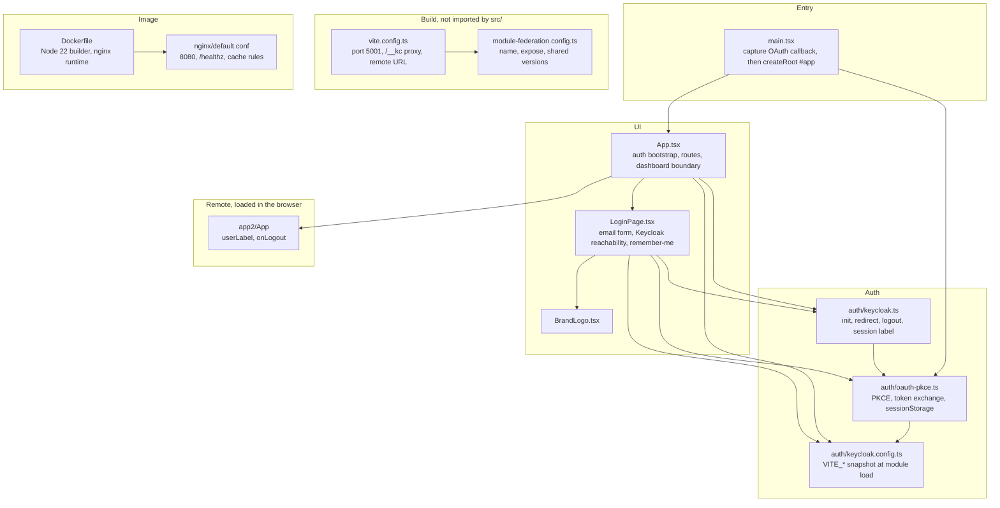
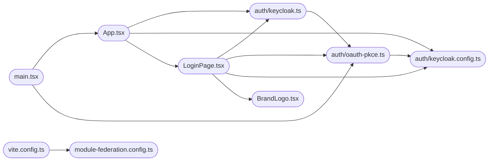
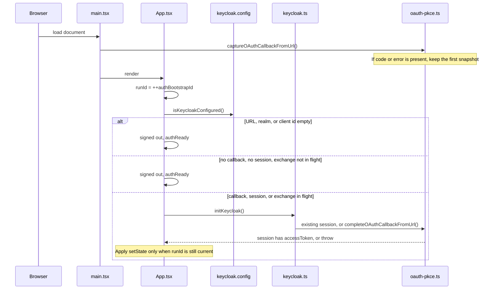
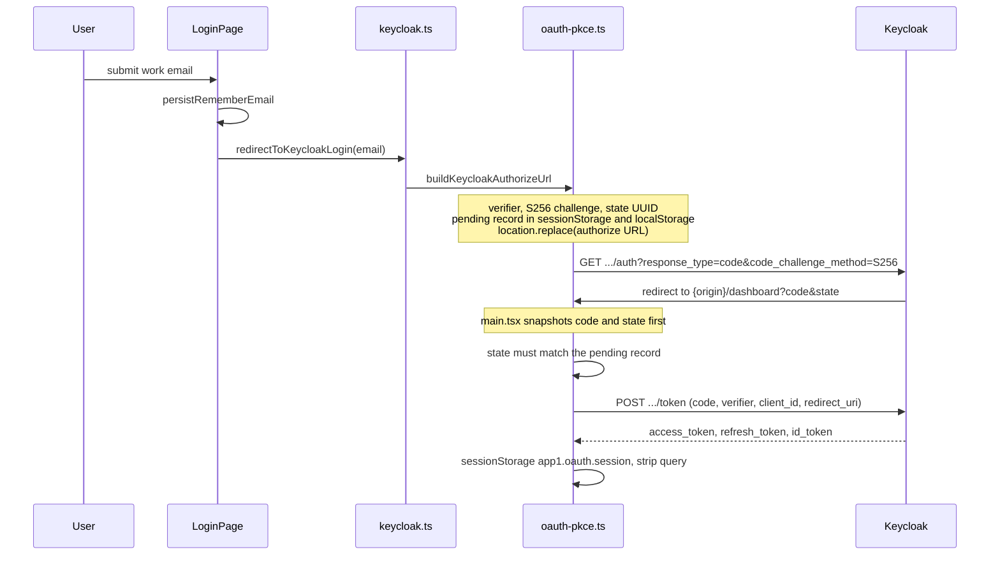
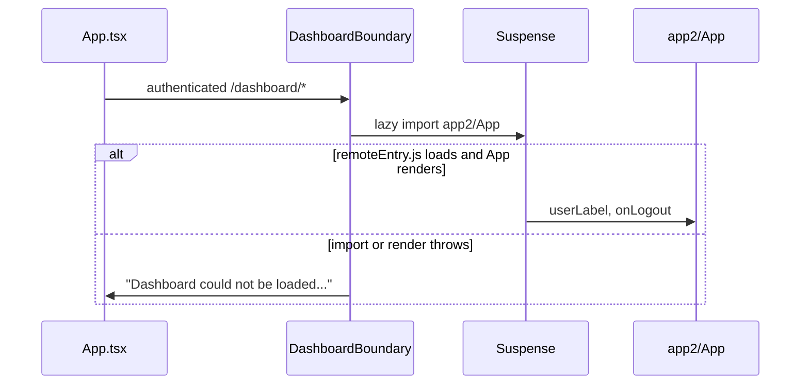

# Architecture

This document describes the internal structure, dependency direction, and browser flows of `web-shell`.

`web-shell` is a **private Vite application** (`github.com/BCBP-SOLUTIONS-FZC-LLC/web-shell`, Node.js 22, React 19.3). The npm package name is `app1` and `"private": true`. Nothing installs it. What ships is a static bundle: the login page, a Keycloak PKCE session, and a Module Federation host that loads the dashboard remote. The production process is nginx on port **8080**, uid **101**. There is no API server, database, or message bus in this repository.

The shell has not been tagged. `package.json` `version` is `0.0.0`. Image tags, the SemVer contract, and how to cut a release are in [VERSIONING.md](./VERSIONING.md).

| This shell owns | Lives elsewhere |
|---|---|
| Login page, route choice, PKCE session in the browser | Passwords, MFA, registration, token issuance (Keycloak) |
| Federation container `app1` / `remoteEntry.js` / expose `./App` | Dashboard screens (`mfe-dashboard`, loaded as `app2`) |
| Props passed into the remote: `userLabel`, `onLogout` | Tenant, role, and feature-flag decisions (IAM services). This shell does not call them |
| Shared singletons `react` `^19.3.0`, `react-dom` `^19.3.0`, `react-router-dom` `^7.18.4` | Any remote other than `app2`. Only that one is wired |
| `GET /healthz` and the static files nginx serves | Cluster rollout. A tag publishes an image. It does not deploy |

`VITE_*` values are compiled into the bundle. They are public.

---

## Layer model

The shell is a browser app, not a Clean Architecture service. The layers below are the real import direction. Inner modules do not import React pages.

> Source: [`docs/architecture/mermaid/layer-model.mmd`](docs/architecture/mermaid/layer-model.mmd)

**Direction:** `keycloak.config.ts` imports nothing from `src/`. `oauth-pkce.ts` imports the config only. `keycloak.ts` imports `oauth-pkce.ts` and is the facade `App` calls for login, logout, and the session label.

Two calls sit beside that facade on purpose:

- `main.tsx` calls `captureOAuthCallbackFromUrl()` before `createRoot`. The callback query has to be copied before any later `replaceState`.
- `LoginPage` calls `isKeycloakServerReachable()` and reads `keycloakConfig.realm` for the status line. Those are not on the facade.

`App` never imports `oauth-pkce.ts`. The dashboard remote is a Vite external (`import('app2/App')`). Tests alias that specifier to `test/fixtures/DashboardApp.tsx`. Production resolves it from `${VITE_APP2_URL}/remoteEntry.js`.

Nothing in CI typechecks this graph with a lint tool. `npm run build` runs `tsc` on `src/` (`noUnusedLocals`, `noUnusedParameters`). A new import from `oauth-pkce.ts` back into a page would be a layering break even though the compiler allows it.

---

## Module dependency graph

Arrows are TypeScript imports under `src/`, plus the build edge from Vite to the federation config.

> Source: [`docs/architecture/mermaid/package-dependencies.mmd`](docs/architecture/mermaid/package-dependencies.mmd)

`App.tsx` also has a dynamic import of `app2/App`. That edge is not a file in this repo.

| Module | May import |
|---|---|
| `keycloak.config.ts` | Vite's `import.meta.env` only |
| `oauth-pkce.ts` | `keycloak.config.ts` |
| `keycloak.ts` | `oauth-pkce.ts` |
| `LoginPage.tsx`, `BrandLogo.tsx` | The facade, and the two LoginPage exceptions above |
| `App.tsx` | Facade, `isKeycloakConfigured`, `LoginPage`, `app2/App` |
| `main.tsx` | `captureOAuthCallbackFromUrl`, `App`, `index.css` |
| `vite.config.ts` | `module-federation.config.ts` and Vite plugins. `src/` does not import it |
| Tests | Production modules, or `test/helpers/load-auth.ts` when the test changes env |

`keycloakConfig` is a snapshot. `env()` runs when the module is first evaluated. A test that changes `VITE_*` must call `vi.resetModules()` and import again through `loadAuthModules()`. A static import keeps the first values for the rest of the file.

---

## Bootstrap flow

`App` decides the route in one effect. React StrictMode runs that effect twice in development. `authBootstrapId` drops the result of the older run.

> Source: [`docs/architecture/mermaid/bootstrap-flow.mmd`](docs/architecture/mermaid/bootstrap-flow.mmd)

Until `authReady` is true the tree is a full-page message: "Completing sign-in…" when the URL is a callback or an exchange is in flight, otherwise "Loading…".

After that, `BrowserRouter` renders:

| Path | Signed out | Signed in |
|---|---|---|
| `/` | `LoginPage` | `<Navigate to="/dashboard" replace>` |
| `/dashboard/*` | `LoginPage` | `AuthenticatedDashboard` |
| anything else | `<Navigate to="/" replace>` | `<Navigate to="/dashboard" replace>` |

`authenticated` means the effect stored `true`. That is `initKeycloak()`'s result, or a session that still has an `accessToken` after the call. A thrown error clears it and keeps the message for `LoginPage`.

---

## Sign-in flow

> Source: [`docs/architecture/mermaid/sign-in-flow.mmd`](docs/architecture/mermaid/sign-in-flow.mmd)

Authorize parameters are `client_id`, `redirect_uri`, `response_type=code`, `scope=openid profile email`, `login_hint`, `code_challenge`, `code_challenge_method=S256`, and `state`.

The redirect URI is `VITE_KEYCLOAK_REDIRECT_URI` when that is set, otherwise `{window.location.origin}/dashboard`. The local realm allows `http://localhost:5001/*` and `http://127.0.0.1:5001/*`.

Discovery and token calls try a list, and stop at the first response:

1. In `import.meta.env.DEV` only, `/__kc` plus the realm path. Vite proxies that to `VITE_KEYCLOAK_URL`. nginx has no `/__kc` location.
2. The configured Keycloak origin plus the path.
3. When that origin contains `localhost`, the same URL with the host rewritten to `127.0.0.1`.

A network failure tries the next candidate. An HTTP error from a candidate is returned as-is. The token error text is surfaced on the login page. `invalid_redirect_uri` and `invalid_grant` get a shorter message.

The id token is split and base64-decoded for `email` and `preferred_username`. The shell does not check the signature. The label is display text. The signed-in flag is the presence of `access_token` from that response.

Logout (`logoutOAuthSession`) deletes the session and the PKCE keys, then navigates to `{origin}/realms/{realm}/protocol/openid-connect/logout` with `client_id` and `post_logout_redirect_uri={origin}/`. With Keycloak unconfigured it navigates to the redirect URI instead.

One exchange runs at a time. `completeOAuthCallbackFromUrl` stores the promise on `tokenExchangeInFlight`. A second caller awaits the same promise. `isOAuthCallbackInProgress()` is that promise being non-null, which is what keeps the bootstrap from treating the page as signed out while the exchange is still running.

---

## Dashboard load

> Source: [`docs/architecture/mermaid/dashboard-load.mmd`](docs/architecture/mermaid/dashboard-load.mmd)

`userLabel` is `session.email`, then `session.username`, then `User`. `onLogout` calls `keycloakLogout()`.

The shared scope is `default`. `react`, `react-dom`, and `react-router-dom` are singletons. The remote is expected to accept those ranges. A failed load does not unmount the router. Refreshing after `mfe-dashboard` is up on `VITE_APP2_URL` (default `http://localhost:5002`) retries the import.

---

## Browser storage

There is no server session. Closing the tab drops the PKCE session. Remember-me survives.

| Key | Store | Written | Cleared |
|---|---|---|---|
| `app1.oauth.session` | `sessionStorage` | After a successful token response. JSON: `accessToken`, optional `refreshToken`, `idToken`, `email`, `username` | Logout, and `clearOAuthSession` |
| `app1.oauth.pkce_verifier`, `app1.oauth.state`, `app1.oauth.redirect_uri` | `sessionStorage` | When the authorize URL is built | After a successful exchange, and on logout |
| `app1.oauth.exchanged_code` | `sessionStorage` | Set to the code just exchanged | Next authorize attempt, and logout. A repeat of the same code returns the stored session |
| `app1.oauth.pending.<state>` | `sessionStorage`, then a copy in `localStorage` | Verifier and redirect URI for that `state` | After a successful exchange. A `localStorage` quota error is ignored. The session copy remains |
| `bcbp.rememberEmail`, `bcbp.loginEmail` | `localStorage` | When the form is submitted with remember checked | When remember is unchecked. Email text only |

Corrupt `app1.oauth.session` JSON is treated as no session.

The callback snapshot (`code`, `state`, `error`, `error_description`) lives in module memory. The first `captureOAuthCallbackFromUrl()` wins. Later calls no-op. `stripOAuthParamsFromUrl` replaces the history entry with the path and drops `code`, `error`, and `state` from the address bar. An empty `pathname` becomes `/`.

---

## Failure domains

| Step | Dependency | Posture | On failure |
|---|---|---|---|
| Open the login page with empty Keycloak env | none | stop | Form explains that `VITE_KEYCLOAK_*` is missing. No fetch |
| Login-page reachability poll | `/.well-known/openid-configuration` every 12s, and on focus | degrade | Amber warning. Submit still attempts the redirect |
| Build the authorize URL | Web Crypto (`crypto.subtle.digest`) | stop | Error on the form. Needs a secure context for S256 |
| Leave for Keycloak | Browser navigation | stop | The shell is gone until Keycloak redirects back |
| Token exchange | Keycloak token endpoint | stop | Login page shows the error. No session is written |
| `state` missing, mismatched, or verifier missing | stored PKCE record | stop | "Start sign-in again". No token request when the verifier is absent |
| `localStorage` rejects the pending copy | `localStorage` | degrade | Authorize continues with the `sessionStorage` copy |
| Second StrictMode effect run | none | ignore | `runId` discards the older `setState` |
| Dashboard import or render | `app2` remote | degrade | Error boundary message. Login route still works |
| `GET /healthz` | nginx only | liveness | `200` and `ok`. Keycloak and `app2` are not checked |

A token HTTP error does not fall through to the next candidate. Only a thrown `fetch` does. The first response, including a 400 from Keycloak, is the result.

---

## Key invariants

| Invariant | Where it holds |
|---|---|
| The shell is a public OAuth client. There is no client secret in the repo or the bundle | Authorize and token requests send `client_id` only |
| `state` is checked before the code is exchanged | `exchangeAuthorizationCode` |
| A code is exchanged once per page load | `app1.oauth.exchanged_code`, and `tokenExchangeInFlight` |
| The callback query is captured before React renders | `main.tsx` calls `captureOAuthCallbackFromUrl` first |
| A stale bootstrap cannot overwrite a newer one | `authBootstrapId` in `App.tsx` |
| Remember-me does not store tokens | `persistRememberEmail` writes `bcbp.loginEmail` only |
| The remote URL is a build-time origin | `VITE_APP2_URL` in `vite.config.ts`. The page URL is not read for it |
| Shared React is one copy | `singleton: true` and `requiredVersion` in `module-federation.config.ts` |
| `/healthz` does not depend on Keycloak or the remote | `nginx/default.conf` returns a constant |
| Federation entry points are not cached as immutable | `remoteEntry.js` and `mf-manifest.json` are `no-cache`. `/assets/` is immutable |
| Auth unit tests see the env they stub | `test/helpers/load-auth.ts` resets the module graph |
| The coverage floor is 95% on statements, branches, functions, and lines | `.github/scripts/coverage-gate.mjs`. CI does not lower it |
| Image base tags are digest-pinned | `validate-quality.yml` rejects a `FROM` line without `@sha256` |

---

## Deployment

### Image

| Piece | Where | Role |
|---|---|---|
| Builder | `node:22-bookworm`, digest-pinned | `npm ci`, then `npm run build` |
| Runtime | `nginxinc/nginx-unprivileged:1.30-alpine`, digest-pinned | Serves `/usr/share/nginx/html` as uid 101. `USER 101` because a named user fails Hadolint DL3066 |
| Listen | 8080 | Same port the local Keycloak compose file publishes. Map the image to another host port when both run |
| Health | `GET /healthz` | Body `ok` |
| Document | `GET /` | `index.html`, `id="app"`, `Cache-Control: no-cache` |
| Federation | `GET /remoteEntry.js`, `GET /mf-manifest.json` | `no-cache`, 404 when the file is absent |

Build args the Dockerfile declares: `BUILD_VERSION`, `SOURCE_DATE_EPOCH`, `VITE_KEYCLOAK_URL`, `VITE_APP2_URL`. Realm, client id, and redirect URI are read by Vite if they are in the build environment. They are not `ARG`s, and `.dockerignore` excludes `.env`, so a plain `docker build` compiles them empty. The image still serves the shell. Sign-in stays on the unconfigured login page until a build provides those three.

CI on `main` pushes `ghcr.io/bcbp-solutions-fzc-llc/web-shell` with the branch tag and `sha-<short>`, then Cosign-signs the digest. A Git tag `vX.Y.Z` publishes image tags `X.Y.Z`, `X.Y`, `X`, and `latest` when the tag has no pre-release suffix. The Git tag keeps the `v`. The static tarball on the GitHub Release is `web-shell_<tag>_dist.tar.gz`. It does not include the nginx `/healthz` location.

There is no Helm chart and no deploy job.

### Local processes

| Process | Port | Command |
|---|---|---|
| Vite dev and preview | 5001, strict | `npm run dev`, `npm run preview` |
| Keycloak `start-dev` | 8080 | `npm run keycloak:setup` |
| Dashboard remote | 5002 by default | Separate repo, `VITE_APP2_URL` |

`/__kc` exists only in the Vite dev server. Preview and the image call Keycloak on `VITE_KEYCLOAK_URL`.

---

## Testing strategy

Vitest 5, happy-dom at `http://localhost:5001/`, Testing Library. `vitest.config.ts` is not the app `vite.config.ts`: the federation plugin is not loaded, and `app2/App` is aliased to the fixture. The fixture throws when `globalThis.__DASHBOARD_THROW__` is set.

| Layer | Path | What it locks |
|---|---|---|
| Unit | `test/unit/` | PKCE candidates, state and verifier checks, session round-trip, config snapshot, facade, `BrandLogo`, `main.tsx` mounting `#app` |
| Integration | `test/integration/` | Login page configured, unconfigured, and error paths, including the Docker hint when Keycloak does not answer |
| End to end | `test/e2e/` | Anonymous and signed-in routes, "Completing sign-in…", callback errors, the remote error boundary, the stale `runId` |
| Smoke | `.github/scripts/smoke-tests.sh` | Image at most 200 MB. `/healthz`, `/`, and `/remoteEntry.js` return 200. `/` contains `id="app"` |

`npm run test:ci` is the gate CI runs: coverage, then `coverage-gate.mjs`. Include is `src/**/*.{ts,tsx}`. Declaration files and CSS are excluded.

Auth tests that need a different env use `stubKeycloakEnv` and `loadAuthModules()`. An unconfigured case stubs whitespace (`' '`) so `env()` trims to empty.

---

## Host and remote checklist

Use this before pointing a host at this image, or before changing `app2`.

**Loading this shell**

- [ ] Serve `index.html` for client-side routes, or use this image's nginx config, which already falls through to `index.html`.
- [ ] Leave `remoteEntry.js`, `mf-manifest.json`, and `index.html` revalidated. Cache `/assets/` as immutable.
- [ ] Keep `GET /healthz` if the orchestrator probes the image. The tarball alone does not include that location.
- [ ] Build with the Keycloak URL, realm, client id, and dashboard origin this environment uses. Rebuilding is required after a change. The running container will not pick up new `VITE_*` values.
- [ ] Register the shell's redirect URI on the Keycloak client. Local default is `{origin}/dashboard`.

**Being the `app2` remote**

- [ ] Serve `remoteEntry.js` at `${VITE_APP2_URL}/remoteEntry.js`.
- [ ] Accept `userLabel?: string` and `onLogout?: () => void` on the default export of `./App`.
- [ ] Share `react`, `react-dom`, and `react-router-dom` as singletons inside the ranges in `module-federation.config.ts`.
- [ ] Fail by throwing if the remote cannot render. The shell's error boundary catches that. A blank successful render is a healthy remote from the shell's point of view.

**Signing the user in**

- [ ] Public client, standard flow, PKCE S256. This shell does not send a client secret.
- [ ] Redirect URI list includes the exact URI baked into the bundle.
- [ ] Scopes `openid`, `profile`, and `email` so the id token can carry the label.

---

## Threat model

Each row is a mechanism in this repo.

| STRIDE | Threat | Where | What the shell does |
|---|---|---|---|
| Spoofing | A forged `state` is paired with an attacker's authorization code | `exchangeAuthorizationCode` | The pending record is keyed by `state`. A mismatch with no pending verifier is rejected before the token request |
| Spoofing | A script writes `app1.oauth.session` and the shell treats the tab as signed in | `getOAuthSession` | The signed-in flag is "this key contains an `accessToken`". There is no role check and no call to an IAM API. The dashboard then loads. XSS in this origin is a full session compromise |
| Spoofing | The displayed email is taken from an unverified id token | `exchangeAuthorizationCode` | The payload is base64-decoded and not signature-checked. It is used as `userLabel` only. The access token is whatever the token endpoint returned |
| Tampering | A query parameter swaps the dashboard origin | `vite.config.ts` | `VITE_APP2_URL` is fixed at build time. The page URL is not consulted |
| Tampering | The remote's script runs in the shell origin | Module Federation | Expected. `VITE_APP2_URL` has to be a remote you trust. The error boundary catches a throw. It does not sandbox the remote |
| Tampering | An open redirect on the way back from Keycloak | `getKeycloakRedirectUri` | The redirect is the configured URI or `{origin}/dashboard`, not a query parameter from the page |
| Repudiation | A sign-in or logout has no server-side audit record here | this repo | Keycloak holds the login audit. This shell only writes browser storage |
| Information disclosure | Tokens sit in `sessionStorage` | `app1.oauth.session` | Any script on this origin can read them. Remember-me does not copy them to `localStorage`. The pending PKCE copy in `localStorage` is the verifier and redirect URI, removed after exchange |
| Information disclosure | `VITE_*` values are visible in the bundle | Vite | They are public configuration. A secret placed in one ships to every browser |
| Information disclosure | The remembered email is readable later on the same browser | `bcbp.loginEmail` | Written only when the user checks remember |
| Denial of service | The login page polls Keycloak forever | `LoginPage` | One discovery request every 12 seconds while the page is mounted, plus one on focus. It does not retry the token endpoint in a loop |
| Denial of service | A huge remote bundle blocks the dashboard route | `Suspense` | The route shows "Loading dashboard…" until the import settles, or the error boundary if it rejects. The login route is a different element |
| Elevation of privilege | A signed-in user is treated as an administrator | `App.tsx` | The shell has no role gate. Reaching `/dashboard` means the token endpoint returned an access token. What that user can do is the remote's concern, and this shell does not forward the token to the remote |

Platform concerns that sit outside this repo: Keycloak credential checks, MFA, realm administration, and whatever API the dashboard calls with a token. This shell does not attach the access token to any request of its own.

---

## Developer tools

| Tool | How to run | What it is for |
|---|---|---|
| Vite | `npm run dev` | Shell at `http://localhost:5001`, `/__kc` proxy, federation remote from `VITE_APP2_URL` |
| Preview | `npm run preview` | Production bundle on port 5001. No `/__kc` proxy |
| Keycloak | `npm run keycloak:setup` | Realm `bcbp`, client `app1`, theme `bcbp`, admin at `http://localhost:8080` |
| Tests | `npm run test:ci` | Unit, integration, end to end, 95% gate |
| Image | `docker build` then `docker run -p 18080:8080` | nginx as the browser will get it. Use 18080 when Keycloak already has 8080 |

The login page's "Trouble logging in?" link is `href="#help"`. It does not open a help route.

---

## Decisions

1. **PKCE in this repo, not `keycloak-js`.** `keycloak-js` is a dependency. `getKeycloak()` returns `null`, and the tests lock that. The authorize redirect, the token POST, and the session key are in `oauth-pkce.ts` so the callback snapshot and the `/__kc` candidate list stay in one place. Adopting the library means replacing that flow and those tests together.

2. **Snapshot the callback before React.** StrictMode and the login page both call `replaceState`. Copying `code` and `state` into module memory at startup is what makes the exchange survive that.

3. **Copy the pending PKCE record to `localStorage`.** Some browser handoffs drop `sessionStorage` across the Keycloak redirect. The copy is removed after a successful exchange. If `localStorage.setItem` throws, sign-in continues with the session copy.

4. **`runId` on the bootstrap effect.** The effect starts an async exchange and also returns early when Keycloak is unconfigured or there is nothing to exchange. A second StrictMode run increments the id. Only the current id may call `setState`.

5. **`/__kc` only when `import.meta.env.DEV` is true.** The dev server can proxy Keycloak and avoid a browser CORS failure against `localhost:8080`. The production bundle must not request a path nginx does not serve, so the candidate is omitted outside Vite dev.

6. **The coverage gate is a script, not a Vitest threshold.** `vitest.config.ts` writes `coverage/coverage-summary.json`. `.github/scripts/coverage-gate.mjs` fails the process under 95% on all four metrics. `validate-test.yml` runs that script. Putting the numbers only in Vitest would let a local `vitest run` and CI disagree.

7. **Numeric nginx user.** The unprivileged image's account is uid 101. `USER nginx` fails Hadolint DL3066, so the Dockerfile and the `chown` use `101`.

8. **Realm and client id are still a build gap.** URL and dashboard origin are Docker build args. Realm, client id, and redirect URI are not. That is recorded in [CHANGELOG.md](./CHANGELOG.md) under known gaps. A production build has to supply them in the environment before `npm run build`.

---

## Documentation assets

Diagrams in this file match the `.mmd` sources under [`docs/architecture/mermaid/`](docs/architecture/mermaid). The index is [`docs/architecture/README.md`](docs/architecture/README.md). Pipeline diagrams and the failure runbooks are under [`docs/`](docs/README.md).

| Document | What it answers |
|---|---|
| [docs/README.md](docs/README.md) | Diagrams, the pipeline, and the runbooks |
| [README.md](./README.md) | How to run the shell, the routes, the image, and CI |
| [VERSIONING.md](./VERSIONING.md) | What a version number means, and how a tag is cut |
| [CONTRIBUTING.md](./CONTRIBUTING.md) | How to add a route, an env var, or a test |
| [CHANGELOG.md](./CHANGELOG.md) | What is true on `main` today, and what is still open |
| [SECURITY.md](./.github/SECURITY.md) | Where to report a vulnerability |
