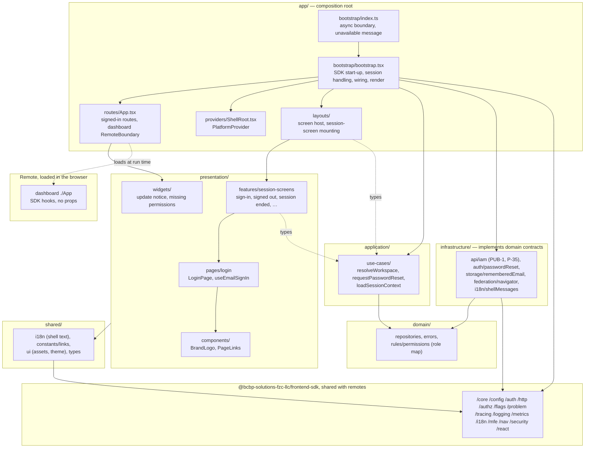
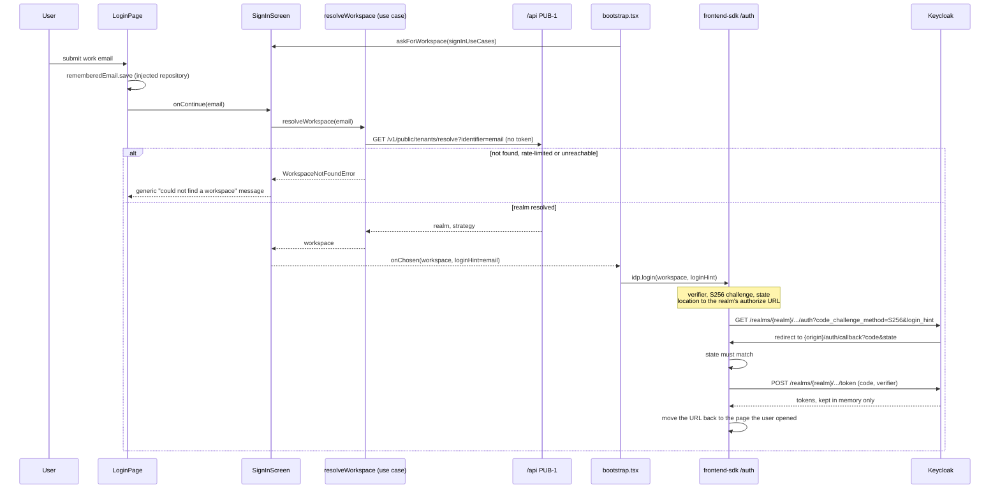
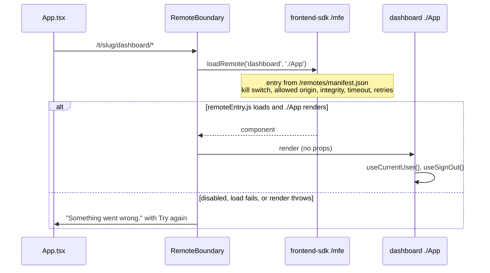

# Architecture

This document describes the internal structure, dependency direction, and browser flows of `web-shell`.

`web-shell` is a **private Rsbuild application** (`github.com/BCBP-SOLUTIONS-FZC-LLC/web-shell`, Node.js 26, React 19.3) built on the platform SDK (`@bcbp-solutions-fzc-llc/frontend-sdk` `1.0.0-alpha.6`). The npm package name is `web-shell` and `"private": true`. Nothing installs it. What ships is a static bundle: the SDK bootstrap, the sign-in and session screens, and a Module Federation host (`shell`) that renders the dashboard remote. The production process is nginx on port **8080**, uid **101**. There is no API server, database, or message bus in this repository.

Current release: `v0.2.0` (remote `dashboard`); `v0.1.0` (remote `app2`) is its rollback. `package.json` `version` matches the latest tag. Image tags, the SemVer contract, and how to cut a release are in [VERSIONING.md](./VERSIONING.md).

| This shell owns | Lives elsewhere |
|---|---|
| The SDK start-up sequence, the email sign-in page, the session screens | Passwords, MFA, registration, token issuance (Keycloak). PKCE, token handling, refresh and idle timeout (the SDK's `/auth`) |
| The IAM ports: PUB-1 resolver and P-35 session context | The IAM APIs, tenant membership, authorization decisions (IAM services, the gateway) |
| Federation host `shell` and the shared map from `@bcbp-solutions-fzc-llc/webpack-preset` | Dashboard screens (`mfe-dashboard`, loaded as `dashboard`) |
| The shell value remotes read through SDK hooks (`user`, `signOut`, `workspace`, `context`) | Each environment's `/config/runtime.json` and `/remotes/manifest.json` (deploy pipeline, CloudFront) |
| `GET /healthz` and the static files nginx serves | Cluster rollout. A tag publishes an image. It does not deploy |

Only `__ENVIRONMENT__` and `__BUILD_VERSION__` are compiled into the bundle. Everything else is runtime configuration.

---

## Layer model

`src/` follows the Frontend Architecture Constitution's structure. Presentation → application → domain; infrastructure implements the domain's contracts; `app/` is the composition root and the only place that knows every layer. Nothing in `src/` imports the bootstrap except the entry. Solid arrows are imports in the real direction, and `npm run arch-lint` checks every one of them; dashed arrows are type-only imports or, for the remote, a load at run time.

> Source: [`docs/architecture/mermaid/layer-model.mmd`](docs/architecture/mermaid/layer-model.mmd)



**Direction:** presentation never imports infrastructure, `app/` or the SDK (the session screens take `/auth` types only); it gets use cases, repositories and state as props from `app/`. `bootstrap.tsx` is the only module that wires the layers together and the only one that renders the app root. `App.tsx` reads session state through SDK hooks and passes it to the widgets; the remote reads its own through SDK hooks (`useCurrentUser`, `useSignOut`).

The SDK is imported through public subpaths only. `@bcbp-solutions-fzc-llc/eslint-plugin` fails a root import (`@bcbp-solutions-fzc-llc/frontend-sdk`) or a deep import, and `npm run lint` runs in `validate-quality`.

---

## Module dependency graph

Arrows are TypeScript imports under `src/`. Dashed, labelled arrows carry only what the label names (types, `en.json`, the `/problem` error classes).

> Source: [`docs/architecture/mermaid/package-dependencies.mmd`](docs/architecture/mermaid/package-dependencies.mmd)

```mermaid
graph LR
    index(["app/bootstrap/index.ts"])
    boot(["app/bootstrap/bootstrap.tsx"])
    app(["app/routes/App.tsx"])
    root(["app/providers/ShellRoot.tsx"])
    host(["app/layouts/sessionScreens.tsx"])
    screen(["app/layouts/screen.tsx"])
    screens(["presentation/features/session-screens"])
    login(["presentation/pages/login\nLoginPage, useEmailSignIn"])
    widgets(["presentation/widgets"])
    comps(["presentation/components\nBrandLogo, PageLinks"])
    usecases(["application/use-cases\nresolveWorkspace, requestPasswordReset,\nloadSessionContext"])
    domain(["domain/\nRememberedEmailRepository, WorkspaceNotFoundError,\nrules/permissions"])
    iam(["infrastructure/api/iam.ts"])
    reset(["infrastructure/auth/passwordReset.ts"])
    remember(["infrastructure/storage/rememberedEmail.ts\n(localStorage)"])
    nav(["infrastructure/federation/navigator.ts"])
    msgs(["infrastructure/i18n/shellMessages.ts"])
    text(["shared/i18n\nshell namespace, en.json"])
    links(["shared/constants/links.ts"])
    sdk(["frontend-sdk subpaths"])

    index --> boot
    index -. en.json .-> text
    boot --> app
    boot --> root
    boot --> host
    boot --> screen
    boot --> usecases
    boot --> domain
    boot --> iam
    boot --> reset
    boot --> remember
    boot --> nav
    boot --> msgs
    boot --> sdk
    root -. types .-> usecases
    root --> sdk
    host --> screens
    host --> screen
    screens --> login
    screens -. types, signIn.ts .-> usecases
    screens --> domain
    screens --> text
    login --> comps
    login -. types .-> domain
    login --> text
    comps --> links
    comps --> text
    links -. types .-> text
    app --> widgets
    app --> text
    app --> sdk
    widgets --> text
    usecases --> domain
    usecases -. types, /problem .-> sdk
    remember -. types .-> domain
    iam --> sdk
    reset --> sdk
    msgs --> text
    msgs --> sdk
    text --> sdk
```

`App.tsx` renders `dashboard` through `RemoteBoundary`. That edge is not a file in this repo.

| Module | May import |
|---|---|
| `domain/` (contracts, errors, `rules/permissions.ts`) | Nothing but SDK types |
| `application/` (use cases) | `domain/`, SDK types and the `/problem` error classes. No React, no browser APIs (ports injected) |
| `infrastructure/` | `domain/`, `shared/i18n`, SDK subpaths. `storage/rememberedEmail.ts` implements `RememberedEmailRepository` over `localStorage`; `i18n/shellMessages.ts` (`registerNamespace` + `setLocale`) changes the page's locale, so only the bootstrap calls it |
| `presentation/pages` | `components`, `domain/`, `application/` types, `shared/` (their words from `shared/i18n`). Never `infrastructure/`, `app/`, the SDK, `application/` values, storage, the network or navigation: the repository, use cases and state come in as props |
| `presentation/components` | `shared/` (`ui`, `i18n`, `constants`) |
| `presentation/widgets` | `shared/i18n` (state and actions are props) |
| `presentation/features/session-screens` | `pages`, `components`, `domain/`, `application/` types, `shared/i18n`, SDK `/auth` types. The screens call the use cases they are given; every failure becomes catalogue words |
| `shared/i18n` | SDK `/i18n` (`t`) and `/react` (`useT`), no shell layer: `en.json`, `catalogues.ts`, `useShellText`, `shellText`, `ShellKey`. Text lookup only: presentation reaches the SDK's i18n runtime through it and nothing else |
| `shared/constants` | `shared/i18n` (link labels are keys) |
| `shared/ui`, `shared/types` | Nothing (assets, styles, ambient types) |
| `app/layouts/` | `screen.tsx`: `react-dom/client`. `sessionScreens.tsx`: the session-screen components, the screen host, `application/` and SDK `/auth` types |
| `app/providers/ShellRoot.tsx` | React, SDK `/react`, the session-context store (`application/`) |
| `app/routes/App.tsx` | `react-router-dom`, `shared/i18n`, the widgets, SDK `/react` (`RemoteBoundary`, `MFEErrorBoundary`, `useRouteTemplate`, `useSessionContext`, `useAppUpdate`). It hands the router's `navigate` to the bootstrap through `onRouter` instead of importing `/nav` |
| `app/bootstrap/bootstrap.tsx` | Every layer except presentation and `shared/constants`, which it reaches through `layouts`, `providers` and `routes` (the composition root; the only module that imports `infrastructure/`: builds the use cases from infrastructure), every SDK subpath it initialises, `shared/ui/index.css` |
| `app/bootstrap/index.ts` | `bootstrap.tsx`, dynamically; `shared/i18n/en.json` statically (the unavailable page cannot use the SDK) |
| `rsbuild.config.ts` | The platform plugin, React, Tailwind, `/version.json`, `config/dev-platform.mjs`. `src/` does not import it |
| Tests | Production modules. `test/integration` replaces SDK subpaths with `vi.mock` fakes; `test/e2e` uses the real SDK with `test/fixtures/` fakes around it |

These rules are enforced twice. `eslint.config.js` (`@typescript-eslint/no-restricted-imports`, `no-restricted-globals`, `no-restricted-properties`; `test/unit/layer-rules.test.ts`) gives editor feedback and covers browser globals: presentation may not use `fetch`, `XMLHttpRequest`, storage, IndexedDB, `location`, `history`, `navigator` or `open`, bare or through `window`, `globalThis`, `self` (and `document.location`); domain and application may not use any browser global. `.dependency-cruiser.cjs` declares every component and its allowed dependencies, and `npm run arch-lint` fails an undeclared dependency, a file in no component, a cycle or an unresolvable import (`test/unit/arch-lint.test.ts`). `app/` has no ESLint layer rule; arch-lint limits `routes`, `providers` and `layouts` to what they render or provide, and only `bootstrap.tsx` may import `infrastructure/`.

---

## Bootstrap flow

`src/app/bootstrap/index.ts` imports `bootstrap.tsx` dynamically: Module Federation needs an async boundary before a shared module is used. The bootstrap runs once per page load, in the SDK's order (SDK design doc §C2).

> Source: [`docs/architecture/mermaid/bootstrap-flow.mmd`](docs/architecture/mermaid/bootstrap-flow.mmd)

```mermaid
sequenceDiagram
    participant Browser
    participant Index as index.ts
    participant Boot as bootstrap.tsx
    participant SDK as frontend-sdk
    participant IAM as /api (IAM)
    participant Screens as session screens (app/layouts)

    Browser->>Index: load document
    Index->>Boot: import('./bootstrap'), bootstrap()
    Boot->>SDK: installTrustedTypesPolicy, loadRuntimeConfig (/config/runtime.json)
    Boot->>SDK: initializeCore (environment from runtime.json, else build-time), setRuntimeConfig
    Note over Boot,SDK: a failure is logged as an error (default /otel), then "The app is unavailable right now."
    Boot->>SDK: tracing, logging, metrics, error handlers, web vitals (consent: SDK default, essential only)
    Boot->>SDK: registerShellMessages: registerNamespace('shell'), setLocale(defaultLocale), before any screen
    Boot->>SDK: createOidcProvider, initializeAuth, setTokenSource
    Boot->>SDK: idp.init()
    alt anonymous
        alt signed-out
            Boot->>Screens: showSignedOut (wait for a click)
        else device-clock
            Boot->>Screens: showDeviceClock (wait for a click)
        else none or login-required
            Boot->>SDK: workspace from the failed attempt, or chooseWorkspace
            opt no known workspace
                Boot->>Screens: askForWorkspace (email → PUB-1)
            end
            Boot->>SDK: idp.login(workspace, loginHint)
        end
    else authenticated, wrong workspace
        Boot->>Screens: showWrongWorkspace (app never renders)
    else authenticated
        Boot->>SDK: idp.subscribe (expired, signed out)
        Boot->>IAM: GET /v1/me/session-context
        Boot->>SDK: authorizer, subject, flags, rememberWorkspace (/t/slug/)
        Boot->>SDK: initializeI18n (detect: P-35 locale), loadManifest, startVersionPolling
        Boot->>Browser: render App inside ShellRoot (PlatformProvider), registerNavigator
        opt no session context
            Boot->>IAM: retry after 1 s, 2 s, 4 s (online network error, timeout, 429, 502-504)
            Boot->>SDK: subject, flags, rememberWorkspace; the provider updates live
        end
    end
```

1. `installTrustedTypesPolicy()`, then `loadRuntimeConfig()` fetches `/config/runtime.json` and validates it.
2. `initializeCore({ serviceName: 'web-shell', domain: 'portal', environment: cfg.environment ?? __ENVIRONMENT__, buildVersion: __BUILD_VERSION__ })`, then `setRuntimeConfig(cfg)`: the deployed `/config/runtime.json` names its environment (`environment`, SDK alpha.6) and the page takes it from there, so one build serves every environment; until every deployed file has the key, the build-time `PLATFORM_ENVIRONMENT` fills in. When the config cannot be loaded, the identity takes the build-time environment so the failure can still be reported. A throw from here on is logged as an essential error (`the app could not start`; logging starts on the default `/otel` when the config never arrived), then reaches `index.ts`, which replaces `#app` with "The app is unavailable right now." (the one text read from `en.json` directly: it shows when the SDK may not have loaded, before the async boundary)
3. Consent stays the SDK's default (essential only), then tracing, logging and metrics against `telemetry.otlpBaseUrl`, `installGlobalErrorHandlers()`, `startWebVitals()`, platform flags from the runtime config. Then `registerShellMessages(cfg.i18n.defaultLocale)` (`infrastructure/i18n/shellMessages.ts`): the shell's `shell` namespace is registered and loaded for the default locale (`setLocale`), so the sign-in screens, which show before step 8, never show raw keys.
4. `createOidcProvider(cfg.auth, workspaceResolver)`, `setTokenSource(initializeAuth(idp))`, `idp.init()`. On a reload or a new tab `init()` may redirect once with `prompt=none` and never settle.
5. Anonymous: see the sign-in flow. The bootstrap returns without rendering the app.
6. Authenticated in the wrong workspace (a trial login through an invitation that landed in another tenant): `showWrongWorkspace`. The app never renders and the workspace is not cached.
7. Authenticated: `idp.subscribe` handles expiry and sign-out (below). The P-35 session context sets the authorizer subject and tenant flags, and `rememberWorkspace` caches the workspace with its slug and moves the URL to `/t/<slug>/`. Without a context: deny-all and platform flags only, with a warning log; after render a network failure while online, a timeout, 429, 502, 503 or 504 (the SDK ApiClient's own rule) is retried after 1 s, 2 s and 4 s, one request per attempt, and a success updates the subject, flags and provider without a reload. A sign-out stops the retries, and a sign-out during these steps stops the boot before the app mounts.
8. `initializeI18n` (the user's P-35 `locale` first, through `detect`), `loadManifest()` (a failure is logged; the app still renders), `startVersionPolling()`.
9. Render `<App>` inside `app/providers/ShellRoot` (a `PlatformProvider` whose `context` follows the retry store and whose `locale` follows `setLocale`) into `#app`. The router's basename is `/t/<slug>` when `slugFromPath` finds one in the URL. The router is registered as the SDK's navigator: a remote's `navigate()` under the basename stays in the page; any other path is a full load.

After render the subscription does two things:

| Session event | What the shell does |
|---|---|
| `expired` | "Session ended" dialog over the app. Sign in calls `signInAgain`, which re-resolves the workspace when the server ended the session and reuses the cache otherwise |
| `anonymous`, `signed-out` (here or in another tab) | Unmount the app, so the previous user's data is not left under the dialog. "You are signed out"; Sign in calls `idp.login({ workspace })`, and the SDK adds `prompt=login` because it recorded the sign-out |

Routes inside the app:

| Path (under the basename) | Element |
|---|---|
| `/dashboard/*` | `RemoteBoundary` for `dashboard` `./App` |
| anything else | `<Navigate to="/dashboard" replace>` |

---

## Sign-in flow

> Source: [`docs/architecture/mermaid/sign-in-flow.mmd`](docs/architecture/mermaid/sign-in-flow.mmd)



Which workspace a signed-out visit uses, in order:

1. The workspace a failed silent attempt named (`reason: 'login-required'`).
2. `chooseWorkspace`: the `/t/<slug>` in the URL (cached or resolved), otherwise the most recently cached workspace.
3. The email screen (`askForWorkspace`). It resolves the email through PUB-1 and returns the workspace with the email as `loginHint`.

A known workspace goes straight to Keycloak, with the remembered email as `login_hint` when there is one. After `reason: 'signed-out'` or `'device-clock'` the bootstrap shows a dialog and waits for a click: an automatic login after a logout would ride the live SSO session and undo it.

PUB-1 → `Workspace`: strategy `shared` is the trial realm, with `tenant_id` as `tenantIdHint` and a slug only when the identifier was one. A dedicated realm's slug is the realm after `auth.paidRealmPrefix` (`tenant-`). The SDK refuses to cache a workspace whose slug and realm disagree, so a paid realm must be named `tenant-<slug>`; the local realm is `tenant-bcbp` for that reason.

The redirect URI is `{origin}{auth.redirectPath}` (`/auth/callback`). The local realm allows `http://localhost:5001/*` and `http://127.0.0.1:5001/*`. PKCE, `state`, the token exchange, refresh, the idle timeout and the cross-tab broadcast are the SDK's (`/auth`); this repo does not implement any of them.

"Not found", a 429 and an unreachable resolver all show one message ("We could not find a workspace for that email."), so the screen never says which input failed.

**Forgot your password?** needs the typed email: the realm decides where the reset happens. The screen resolves it through PUB-1 (same generic message on failure) and sends the browser to `{auth.idpOrigin}/realms/{realm}/login-actions/reset-credentials?client_id={auth.clientId}` (`infrastructure/auth/passwordReset.ts`); Keycloak e-mails the reset link. Without an email the page asks for one first. The SDK has no reset helper, so this is the shell's.

**Help and legal links** (`shared/constants/links.ts`) render only when their URL is set, so the page has no dead links; none is published yet.

---

## Dashboard load

> Source: [`docs/architecture/mermaid/dashboard-load.mmd`](docs/architecture/mermaid/dashboard-load.mmd)



The shell passes no props. `dashboard` reads the user with `useCurrentUser()` and signs out with `useSignOut()` (global by default: the Keycloak session ends too, and every tab follows), from the shell value `PlatformProvider` holds.

`loadRemote` reads the entry from the manifest the bootstrap loaded, checks the kill switch (`remotes.killSwitch`, flag `remote.dashboard.disabled`) and the entry origin (the page's, or `remotes.allowedOrigins`), injects `remoteEntry.js` as a classic script with its `integrity`, and reads the container from `window.__platform_mfe_dashboard` (`__platform_mfe_<name>` since alpha.4). A remote must therefore be built with `@bcbp-solutions-fzc-llc/webpack-preset` (`role: 'remote'`, library type `var`; webpack, Rspack or Rsbuild). The share scope gives it this shell's React, OTel API and SDK; a remote built against a newer SDK than the shell's is refused at share negotiation, inside the boundary. "Try again" creates a new lazy import.

---

## Browser storage

Tokens are never written to storage. A reload restores the session from Keycloak's SSO cookie with `prompt=none`.

| Key | Store | Written by | Purpose |
|---|---|---|---|
| `@bcbp-solutions-fzc-llc/frontend-sdk:workspaces` | `localStorage` | SDK, `rememberWorkspace` | Cached workspaces (realm, slug), so a return visit skips the email screen |
| `@bcbp-solutions-fzc-llc/frontend-sdk:session-id`, `:auth:last-activity`, `:auth:last-user` | `localStorage` | SDK | Telemetry session id, idle timeout across tabs, user change detection |
| `bcbp.rememberEmail`, `bcbp.loginEmail` | `localStorage` | `infrastructure/storage/rememberedEmail.ts` (behind the domain's `RememberedEmailRepository`) | "Remember Email" only. Needed before a workspace is known, so it does not use the SDK's per-workspace `storage()`. Every access is wrapped in `try`; blocked storage just forgets |

Remotes that need storage use `storage(appId)` from `/storage`, which is namespaced per workspace and refuses token-like keys.

---

## Failure domains

| Step | Dependency | Posture | On failure |
|---|---|---|---|
| Identity and runtime config | `/config/runtime.json` | stop | "The app is unavailable right now." with Try again. Logged as the essential error `the app could not start` (to the collector, default `/otel`); alert in [the runbook](docs/runbook-startup-failure.md) |
| Silent restore | Keycloak SSO session | degrade | `anonymous`; the sign-in flow runs |
| Resolve the email | PUB-1 | stop on that screen | One generic message. The user can retry |
| Leave for Keycloak | Browser navigation | stop | The shell is gone until Keycloak redirects back |
| Session context | P-35 | degrade, then recover | Warning log. Deny-all permissions and platform flags until it answers; after a transient failure (a network failure while online, a timeout, 429, 502, 503 or 504 (the SDK ApiClient's own rule)) it is retried after 1 s, 2 s, 4 s, one request per attempt, and applied live (any other answer, offline included, is final) (the router moves under `/t/<slug>/` then). A notice with Reload says some actions are hidden |
| Remote manifest | `/remotes/manifest.json` | degrade | Error log. The app renders; `RemoteBoundary` shows its error |
| Dashboard load or render | `dashboard` remote | degrade | Boundary message with "Try again". The rest of the shell keeps running |
| The shell's own screens render | `App.tsx` and its widgets | stop that tree, recover on retry | The SDK's `MFEErrorBoundary` (`mfe="web-shell"`) logs the error (and records it for the SDK's web-error metric, which counts once Tier 1 is ratified), then shows `AppError`: "Something went wrong on this page.", the trace or request reference, and Try again. Never the error's own message. Instead of a blank page |
| Telemetry export | `/otel` | ignore | Bounded queues in the SDK. v1 exports `essential` only (errors and essential warnings), by decision |
| `GET /healthz` | nginx only | liveness | `200` and `ok`. Keycloak, IAM and `dashboard` are not checked |

---

## Key invariants

| Invariant | Where it holds |
|---|---|
| The shell is a public OAuth client. There is no client secret in the repo or the bundle | Runtime config has a `clientId` only |
| Tokens never touch storage | SDK `/auth`. `no-raw-storage` lint rule on `src/` (off only for `src/infrastructure/storage/rememberedEmail.ts`) |
| No login starts without a click after a logout | `showSignedOut`, `showDeviceClock`, `showSessionEnded` |
| The app never renders for a wrong-workspace login | `isWrongWorkspace` check before render |
| The bootstrap runs once, behind the async boundary | `src/app/bootstrap/index.ts` |
| Remotes take React, the OTel API and the SDK from the shell | Preset shared map; the plugin's `ProvideSdkRspackPlugin` provides every SDK subpath |
| Remote entries load only from allowed origins, pinned by integrity outside local, dev and test | SDK `/mfe` manifest validation |
| Every script the build emits is integrity-pinned | Preset `ChunkIntegrityPlugin` (the entry in `index.html`, every lazy chunk) |
| The bundle needs no `eval` and no inline script | Preset output, Rsbuild `inlineScripts: false` (external scripts only) |
| `/healthz` does not depend on Keycloak, IAM or the remote | `nginx/default.conf` returns a constant |
| Per-environment files are revalidated; hashed assets are immutable | `index.html`, `/config/runtime.json`, `/remotes/manifest.json`, `/version.json` are `no-cache`. `/assets/` is immutable |
| Source maps are not shipped | Dockerfile and `prepare-release-asset.sh` delete them; the smoke script and suite fail on a `.map`. A release keeps them as a workflow artifact (`sourcemaps-<tag>`) |
| Only extension-less paths get `index.html`; cache headers per location; dotfiles 404 | `nginx/default.conf`; `test/smoke/deployment.test.ts` checks it against the built image |
| Every response is compressed when it can be and carries baseline security headers, without the nginx version | `nginx/default.conf` (`gzip`, `add_header_inherit merge`, `server_tokens off`); smoke image mode |
| Every shell screen passes axe-core (contrast excepted) | `test/integration/accessibility.test.tsx` |
| The coverage floor is 95% on statements, branches, functions, and lines | `.github/scripts/coverage-gate.mjs`. CI does not lower it |
| Image base tags are digest-pinned | `validate-quality.yml` rejects a `FROM` line without `@sha256` |

---

## Deployment

### Image

| Piece | Where | Role |
|---|---|---|
| Builder | `node:26-bookworm`, digest-pinned | `npm ci` with the BuildKit secret `npm_token` (GitHub Packages), `npm run build`, delete `*.map` |
| Runtime | `nginxinc/nginx-unprivileged:1.31-alpine`, digest-pinned | Serves `/usr/share/nginx/html` as uid 101. `USER 101` because a named user fails Hadolint DL3066 |
| Listen | 8080 | Same port the local Keycloak compose file publishes. Map the image to another host port when both run |
| Health | `GET /healthz` | Body `ok` |
| Document | `GET /` | `index.html`, `id="app"`, `Cache-Control: no-cache` |
| Runtime files | `GET /config/runtime.json`, `/remotes/manifest.json`, `/version.json` | `no-cache`, 404 when the file is absent |

Build args: `BUILD_VERSION`, `SOURCE_DATE_EPOCH`, `PLATFORM_ENVIRONMENT` (default `prod`; only a fallback now: each environment's `runtime.json` names its own `environment`). The image ships `public/config/runtime.json` (SDK defaults: `https://auth.bcbpsolutions.com`, client `tender-web`) and an empty manifest `{}`. An environment serves its own files over those paths, from CloudFront or a mount. The image sends no CSP or HSTS: CloudFront does, and until it exists (next month) each environment mounts `nginx/security.d/csp.conf` and `hsts.conf` and routes `/api`, `/otel`, `/csp-report` and `/remotes/dashboard/` on the same origin at its ingress ([docs/hosting-without-cloudfront.md](docs/hosting-without-cloudfront.md)).

CI on `main` pushes `ghcr.io/bcbp-solutions-fzc-llc/web-shell` with the branch tag and `sha-<short>`, then Cosign-signs the digest. A Git tag `vX.Y.Z` publishes image tags `X.Y.Z`, `X.Y`, `X`, and `latest` when the tag has no pre-release suffix. The Git tag keeps the `v`. The static tarball on the GitHub Release is `web-shell_<tag>_dist.tar.gz`, without source maps (the release keeps them as the workflow artifact `sourcemaps-<tag>`). `BUILD_VERSION` is the version without the `v`. Releases so far: `v0.1.0`, `v0.2.0`. It does not include the nginx `/healthz` location.

There is no Helm chart and no deploy job.

### Local processes

| Process | Port | Command |
|---|---|---|
| Rsbuild dev server | 5001 | `npm run dev` |
| Static preview of `dist/` | 5001 | `npm run preview` |
| Keycloak `start-dev` | 8080 | `npm run keycloak:setup` |
| Dashboard remote | 5002 | Separate repo, entry in `config/remotes.local.json` |

The dev server serves `config/runtime.local.json` and `config/remotes.local.json`, stubs PUB-1 and P-35 (realm `tenant-bcbp`, slug `bcbp`), and drops `/otel` posts (`config/dev-platform.mjs`). `DEV_API_URL` proxies `/api` to a real API instead. The preview and the image have none of that; they serve the files in `dist/`.

---

## Testing strategy

Vitest 5, happy-dom at `http://localhost:5001/`, Testing Library. `vitest.config.ts` defines `__ENVIRONMENT__` and `__BUILD_VERSION__`; it does not load Rsbuild or Module Federation.

| Layer | Path | What it locks |
|---|---|---|
| Unit | `test/unit/` | PUB-1 and P-35 mappings and the port calls, the entry point's fatal path, remember-email with blocked storage, the screen host, `BrandLogo`, the session-context retry and store, the navigator adapter |
| Integration | `test/integration/` | The login page and the carousel, every session screen, `App` routes and props, and the bootstrap: the exact initialisation order, each anonymous reason, wrong workspace, missing context and its background retry, sign-out during boot, i18n `detect`, navigator registration, start-up failure reporting, manifest failure, expiry and sign-out events; axe-core over every shell screen (`accessibility.test.tsx`) |
| End to end | `test/e2e/` | The real bootstrap and SDK (inlined by Vitest, fresh per simulated page load) against a fake Keycloak and network: PKCE sign-in, `/t/<slug>/`, the remote's SDK hooks and permissions, deny-all, an IAM outage that recovers in the background, a failing remote, global sign-out (form POST), the device clock |
| Browser | `test/browser/`, CI `browser` | The production build in Chromium, Firefox and WebKit under the production CSP and Trusted Types, over HTTPS, with a fake Keycloak on a second origin: self-hosted fonts and hashed images, PKCE sign-in, the remote's entry with integrity and the share scope, `navigate()` without a reload, the sign-out form POST under `form-action`, the start-up failure reaching `/otel`, colour contrast (axe) |
| Dashboard contract | `test/browser/dashboard.spec.ts`, CI `dashboard-contract` | The real mfe-dashboard build in this shell under the production CSP (informational) |
| Smoke | `test/smoke/`, `.github/scripts/smoke-tests.sh` | Image at most 200 MB and the startup gate, then the suite against the container: SPA rule, Cache-Control per location, script integrity, 404s, runtime config and manifest validated by the SDK. With `SMOKE_MODE=live`, a deployment's security headers too |

`npm run test:ci` is the gate CI runs: coverage, then `coverage-gate.mjs` (95%; 100% today). Include is `src/**/*.{ts,tsx}`. Declaration files and CSS are excluded. `test/smoke` and `test/browser` are excluded from `npm test`: the first runs with `vitest.smoke.config.ts` against `SMOKE_BASE_URL`, the second with Playwright (`npm run build && npm run test-browser`). CI also fails a build over its size budget (`npm run budget`: entry, total JS and CSS, largest file, images).

The bootstrap test replaces every SDK subpath with a fake that records its call, so the order is asserted directly. The e2e suite then runs the same bootstrap with the real SDK, so the wiring is also checked against the SDK's actual behaviour (PKCE, the `/t/<slug>/` move, hooks, sign-out). Tests of SDK behaviour itself belong in the SDK repository. The full test contract is in [LLD §12](docs/lld/web-shell-lld.md#12-testing).

---

## Host and remote checklist

Use this before serving this image in an environment, or before changing `dashboard`.

**Serving this shell**

- [ ] Serve `index.html` for extension-less client-side routes only, as `platform-reactcommon` `examples/cloudfront/spa-rewrite.js` does (this image's nginx config follows it). Missing config, remote, asset and API files must stay 404.
- [ ] Serve this environment's `/config/runtime.json` and `/remotes/manifest.json`, revalidated. Cache `/assets/` as immutable.
- [ ] Route `/api` to the platform API (PUB-1 and P-35 must exist), `/otel` and `/csp-report` to the collector, and `/remotes/dashboard/` to the dashboard's files, all on the shell's origin.
- [ ] Send the platform's CSP with the Trusted Types policies (`platform-reactcommon/examples/cloudfront`), with the IdP origin in `form-action` (the global sign-out POSTs to Keycloak), and HSTS. From CloudFront, or until it exists by mounting `nginx/security.d/csp.conf` and `hsts.conf`; never both.
- [ ] Run `SMOKE_MODE=live npm run test-smoke` against the environment.
- [ ] Keep `GET /healthz` if the orchestrator probes the image. The tarball alone does not include that location.
- [ ] Register `{origin}/auth/callback` as a redirect URI, and the origin as a post-logout redirect, on the Keycloak client in every workspace realm.

**Being the `dashboard` remote**

- [ ] Build with `pluginPlatform({ role: 'remote', name: 'dashboard', exposes: { './App': … } })` (Rsbuild), or `platformRspackConfig` / `platformWebpackConfig` with the same options. A Vite ES-module remote does not load.
- [ ] List the entry in the manifest with `version`, `ownerDomain` and, outside local, dev and test, `integrity` (mfe-dashboard's build writes `remote-manifest-entry.json`).
- [ ] Pass `npm run test-contract` here with the remote's build (`REMOTE_DIST`).
- [ ] Take no props from the shell. Read the user, workspace, sign-out and session context through the SDK hooks (`useCurrentUser`, `useWorkspace`, `useSignOut`, `useSessionContext`).
- [ ] Initialise nothing. Read the shell's state through the SDK.
- [ ] Fail by throwing if the remote cannot render. The boundary catches that.

**Signing the user in**

- [ ] Public client, standard flow, PKCE S256. This shell does not send a client secret.
- [ ] Paid realms are named `tenant-<slug>`; the trial realm is `auth.trialRealm`.

---

## Threat model

Each row is a mechanism in this repo or in the SDK it relies on.

| STRIDE | Threat | Where | What the shell does |
|---|---|---|---|
| Spoofing | A forged `state` is paired with an attacker's authorization code | SDK `/auth` | `state` and the PKCE verifier are checked before the token request |
| Spoofing | A script plants a session in storage | SDK `/auth` | There is no stored session to plant. Tokens are in memory |
| Spoofing | A trial login lands in another tenant than the invitation's | `bootstrap.tsx` | `isWrongWorkspace` stops the render and the workspace is not cached |
| Tampering | A query parameter or manifest entry swaps the remote origin | SDK `/mfe` | Entries load only from the page's origin or `remotes.allowedOrigins`, and are integrity-pinned outside local, dev and test |
| Tampering | A chunk on the CDN is swapped | Preset `ChunkIntegrityPlugin` | Every script carries `integrity`; a mismatch fails as a chunk-load error |
| Tampering | The remote's script runs in the shell origin | Module Federation | Expected. A remote is trusted code. The boundary catches a throw. It does not sandbox the remote |
| Tampering | An open redirect on the way back from Keycloak | SDK `/auth` | The redirect URI is `{origin}{redirectPath}` from the runtime config; return URLs are checked with `isSafeRedirect` |
| Repudiation | A sign-in or logout has no server-side audit record here | this repo | Keycloak holds the login audit. Browser logs carry `trace_id` and `session_id` once telemetry is consented |
| Information disclosure | An XSS reads tokens from storage | SDK `/auth` | Nothing to read in storage. XSS can still act as the user while the page is open; the CSP and Trusted Types are the defence |
| Information disclosure | Runtime config values are public | `/config/runtime.json` | They are public configuration. A secret placed there ships to every browser |
| Information disclosure | The remembered email is readable later on the same browser | `bcbp.loginEmail` | Written only when the user checks the box |
| Information disclosure | The previous user's data stays on screen after a sign-out | `bootstrap.tsx` | The app is unmounted before "You are signed out" is shown |
| Denial of service | The email screen hammers PUB-1 | `SessionScreens.tsx` | One request per submit; PUB-1 is rate-limited per IP |
| Denial of service | A slow or huge remote blocks the page | SDK `/mfe` | `remotes.loadTimeoutMs` and `retries`; the boundary shows its error and the shell keeps running |
| Elevation of privilege | A signed-in user is shown actions they cannot perform | `permissions.ts`, SDK `/authz` | UI permissions are hints from P-35 roles; without a context the authorizer denies all. The gateway and services decide |

Platform concerns outside this repo: Keycloak credential checks, MFA, realm administration, token validation and identity headers (Envoy, IAM AuthZ), and the CSP headers.

---

## Developer tools

| Tool | How to run | What it is for |
|---|---|---|
| Rsbuild dev server | `npm run dev` | Shell at `http://localhost:5001` with the dev stand-ins |
| Preview | `npm run preview` | `dist/` on port 5001. Uses `dist/config/runtime.json` (the production default) |
| Keycloak | `npm run keycloak:setup` | Realm `tenant-bcbp`, client `app1`, theme `bcbp`, admin at `http://localhost:8080` |
| Lint | `npm run lint` | ESLint, typescript-eslint, React hooks, platform rules |
| Tests | `npm run test:ci` | Unit, integration and e2e, 95% gate |
| Image | `docker build --secret id=npm_token,env=NODE_AUTH_TOKEN` then `docker run -p 18080:8080` | nginx as the browser will get it. Use 18080 when Keycloak already has 8080 |

The login page's "Trouble logging in?" link is not rendered until its official URL is set in `src/shared/constants/links.ts` (none exists yet; LLD §15).

---

## Decisions

1. **The platform SDK owns sign-in.** PKCE, tokens, refresh, idle timeout and cross-tab sign-out are the SDK's `/auth`, tested once there. The shell's previous PKCE implementation, its `sessionStorage` session and `keycloak-js` are removed. The shell keeps only what the SDK leaves to it: the screens and the IAM ports.

2. **Rsbuild instead of Vite.** The SDK's preset supports webpack 5, Rspack 2 and, since `1.0.0-alpha.2`, Rsbuild 2 (`@bcbp-solutions-fzc-llc/webpack-preset/rsbuild`). It does not support Vite: the shared map, the SDK provider plugin and chunk integrity are bundler plugins, and `loadRemote` expects `var` containers. Rsbuild runs on Rspack, keeps a Vite-like config, and the plugin uses Rspack's webpack-compatible Module Federation (v1), so this shell loads remotes built with any of the three. Rsbuild's own `moduleFederation` option (the v2 runtime) must stay unset; the plugin refuses it.

3. **TypeScript 6, not 7.** `typescript-eslint` supports `<6.1.0`, and TypeScript 7 (the native port) does not offer the JavaScript API its parser uses. The SDK builds on 6. Revisit when `typescript-eslint` supports 7.

4. **The email screen is the existing login page.** `askForWorkspace` renders `LoginPage` and resolves the email through PUB-1, instead of the SDK example's slug-or-email form. The email doubles as `login_hint`.

5. **Remember-email uses `localStorage` directly.** The SDK's `storage()` is per workspace and ignores writes before sign-in, which is exactly when this value is needed. It holds the typed email only.

6. **Screens mount outside the app root.** `app/layouts/screen.tsx` renders into a fixed, full-screen `#shell-screen` host that is hidden when empty, so a dialog can sit over a running app and the sign-in page is visible while `#app` is still empty.

7. **The shell no longer exposes a container.** The SDK's model is a shell that hosts remotes and is not one. `remoteEntry.js` and `./App` are gone.

8. **Local platform stand-ins live in the dev server.** `config/dev-platform.mjs` serves the runtime config and manifest and stubs PUB-1 and P-35, so `npm run dev` works with only Keycloak running. Nothing of it reaches the bundle or the image.

9. **The coverage gate is a script, not a Vitest threshold.** `vitest.config.ts` writes `coverage/coverage-summary.json`. `.github/scripts/coverage-gate.mjs` fails the process under 95% on all four metrics. `validate-test.yml` runs that script. Putting the numbers only in Vitest would let a local `vitest run` and CI disagree.

10. **Numeric nginx user.** The unprivileged image's account is uid 101. `USER nginx` fails Hadolint DL3066, so the Dockerfile and the `chown` use `101`.

11. **The e2e suite runs the real SDK in-process.** Following `platform-reactcommon` `test/e2e`, the shell boots under happy-dom against a fake Keycloak and network, with only the remote's entry script stubbed. Vitest inlines the SDK and the suite clears the SDK's runtime global and resets modules on each simulated page load, using only the SDK's public behaviour, no test internals.

12. **Smoke runs against the image, not a stand-in.** The SDK's smoke suite serves its examples through a CloudFront stand-in; here the production server is nginx, so CI runs the same kind of suite against the built container (`SMOKE_MODE=image`), and the same file checks a deployment with `SMOKE_MODE=live`.

13. **Fonts are self-hosted.** Geist and Inter come from Fontsource (`@fontsource-variable/*`, SIL OFL 1.1) and are bundled into `/assets/` with a hash, so `font-src 'self'` and `style-src 'self'` hold and nothing loads from Google. `tools.cssLoader.url` bundles relative `url()`s and leaves root-relative ones (`public/`) as written.

14. **v1 consent is essential only: the SDK's default.** There is no analytics consent manager in v1. The SDK's runtime starts with an essential-only consent provider, so the shell sets none (an earlier stand-in, `platform/consent.ts`, duplicated that default and was removed). A consent manager would call `setConsentProvider` in the bootstrap.

15. **Updates are offered, not forced.** `App` shows "A new version is available." with Reload when `useAppUpdate()` reports one; the user may be mid-task in the remote.

16. **A failed session context is retried, not left for the page's life.** Ported from alpha.4's reference shell (`application/use-cases/loadSessionContext.ts`, `ShellRoot.tsx`): three retries of transient failures, applied through a store the provider reads, so permissions appear without a reload. Unlike the reference shell, this one has a router basename, so a late context that moves the URL rebuilds the router.

17. **The real dashboard is tested here, but does not gate this repo.** The browser suite's stub remote proves the shell; `dashboard.spec.ts` proves the pairing with a real mfe-dashboard build. CI runs it against the dashboard's `main` and reports it without blocking the image push, since that branch moves with another team.

18. **The CSP comes from the edge; the image only carries it when there is no edge.** Two CSPs are both enforced, so the image ships none and includes `/etc/nginx/security.d/*.conf`, mounted only where no CloudFront fronts it (every environment until next month).

---

## Documentation assets

Diagrams in this file match the `.mmd` sources under [`docs/architecture/mermaid/`](docs/architecture/mermaid). The index is [`docs/architecture/README.md`](docs/architecture/README.md). Pipeline diagrams and the failure runbooks are under [`docs/`](docs/README.md).

| Document | What it answers |
|---|---|
| [docs/lld/web-shell-lld.md](docs/lld/web-shell-lld.md) | The contract: responsibilities, mappings, start-up order, flows, hosting, tests, open items |
| [docs/README.md](docs/README.md) | Diagrams, the pipeline, and the runbooks |
| [docs/architecture/constitution-assessment.md](docs/architecture/constitution-assessment.md) | Compliance with the Frontend Architecture Constitution, the target structure and the migration roadmap; decisions in [docs/adr/](docs/adr/README.md) |
| [docs/observability.md](docs/observability.md) | Metric tiers, identity labels, the shell's metric inventory, and how to add a metric |
| [.claude/CLAUDE.md](.claude/CLAUDE.md) | Critical rules and reference for Claude Code; `.claude/hooks/check-diagrams.mjs` checks this file's diagrams against their sources |
| [README.md](./README.md) | How to run the shell, the routes, the image, and CI |
| [VERSIONING.md](./VERSIONING.md) | What a version number means, and how a tag is cut |
| [CONTRIBUTING.md](./CONTRIBUTING.md) | How to add a route, a config key, or a test |
| [CHANGELOG.md](./CHANGELOG.md) | What is true on `main` today, and what is still open |
| [SECURITY.md](./.github/SECURITY.md) | Where to report a vulnerability |
