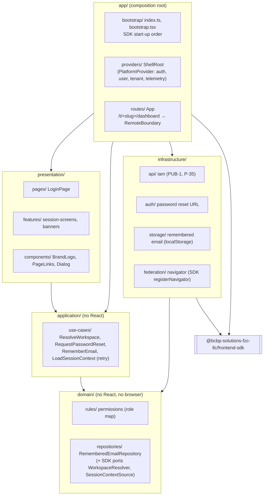

# web-shell against the Frontend Architecture Constitution 1.0

Assessment of `main` at `6901bdc` (SDK `1.0.0-alpha.6`, 2026-11-06), with the outputs the constitution requires for an existing microfrontend: assessment, violations, target architecture, folder plan, dependency cleanup, migration roadmap and ADRs ([`docs/adr/`](../adr/)). Every finding below is checkable in the repository.

## 1. Assessment

web-shell is the **shell**, not a domain microfrontend. Per the constitution's Module Federation section it owns navigation, layout, authentication bootstrap, runtime configuration, shared providers and MFE registration; it owns no business domain. Most of what it owns is implemented by the platform SDK (`@bcbp-solutions-fzc-llc/frontend-sdk`), which the shell configures and wires.

| Constitution area | Status | Evidence |
|---|---|---|
| Domain ownership | ✅ | No business logic of any domain (tenders, contracts…); the dashboard is the remote `dashboard` |
| Required project structure | ❌ | `src/{pages,platform,components}` (V1) |
| Dependency rules (presentation → application → domain; infrastructure implements contracts) | ❌ | Presentation reaches storage and infrastructure (V2, V3) |
| State management | ⚠️ ADR 0002 | No server-state lists or client stores; shared cross-MFE state is the shell's (SDK `PlatformProvider`), as required |
| API access through repositories | ✅ | Only `platform/iam.ts` calls APIs, through the SDK `ApiClient`; implements the SDK ports `WorkspaceResolver`, `SessionContextSource` |
| Runtime configuration | ✅ / ⚠️ | `/config/runtime.json` for every environment value, including `environment` (alpha.6); the build-time fallback remains until each deployed file names it (V5) |
| Module Federation, remote loading | ✅ | Entries from `/remotes/manifest.json` with integrity; no hard-coded remote URL |
| Authentication centralised | ✅ | One OIDC provider (SDK) in the shell; remotes use `useCurrentUser`, `useSignOut` |
| Shared libraries | ✅ | Only platform SDK, preset and lint plugin are shared; no domain code shared |
| Design system | ⚠️ ADR 0006 | No `platform-design-system` exists yet; shell-local Tailwind + daisyUI components |
| Observability | ✅ ADR 0003 | OpenTelemetry tracing, logging, metrics, correlation ids, error boundaries (`RemoteBoundary`) from the SDK; the SDK's `PlatformProvider` is the `TelemetryProvider` |
| Accessibility (WCAG 2.1 AA) | ✅ | axe-core (happy-dom) on every screen; axe colour contrast in Chromium, Firefox, WebKit |
| Security | ✅ | Production CSP with Trusted Types enforced by the browser suite; no secrets; tokens in memory only |
| Internationalisation | ❌ | About 30 hard-coded user-facing strings; the SDK's `/i18n` (the platform localisation framework) is initialised but not used for the shell's text (V4) |
| Testing | ✅ | Vitest unit/integration (100% coverage), React Testing Library, Playwright in three engines, contract tests (SDK contract cases from IAM's swagger; the real dashboard build) |
| Deployment: S3 + CloudFront, build once | ⚠️ ADR 0007 | Interim nginx image until CloudFront (next month); the release tarball is the S3 artefact; one build per environment is now possible (V5) |

## 2. Violations

| # | Rule | Where | Change |
|---|---|---|---|
| V1 | Required project structure | `src/pages`, `src/platform`, `src/components` | Move to `app/`, `presentation/`, `application/`, `domain/`, `infrastructure/`, `shared/` (§4) |
| V2 | Presentation → LocalStorage forbidden | `src/pages/useEmailSignIn.ts` → `src/pages/rememberEmail.ts` (`localStorage`) | `RememberedEmailRepository` contract in `domain/`, `LocalStorageRememberedEmail` in `infrastructure/storage/`, used through a use case |
| V3 | Presentation → infrastructure / browser navigation | `src/platform/SessionScreens.tsx` calls `workspaceResolver.resolve` (PUB-1), `passwordResetUrl`, `window.location.assign` | Use cases `ResolveWorkspace`, `RequestPasswordReset` in `application/use-cases/`; screens call them |
| V4 | All user-facing text localised | `LoginPage.tsx`, `SessionScreens.tsx`, `App.tsx`, `PageLinks.tsx`, `links.ts`, `useEmailSignIn.ts`, `index.ts` | Shell namespace in the SDK's `/i18n` (`registerNamespace('shell', …)`, `useT('shell')` / `t('shell', …)`), English catalogue `shared/i18n/en.json` |
| V5 | Build once, deploy everywhere | `__ENVIRONMENT__` / `PLATFORM_ENVIRONMENT` fallback in `bootstrap.tsx` | Remove once every deployed `runtime.json` names `environment` (LLD §15) |

Not violations, recorded as decisions: state libraries (ADR 0002), telemetry provider (0003), runtime config schema (0004), localisation framework (0005), design system (0006), hosting (0007), the shell's thin domain (0001), tests at the repository root (0008).

## 3. Target architecture

`app/` is the composition root: the only place that wires infrastructure into use cases and renders. The SDK sits under infrastructure and app; presentation never imports it except the React hooks of `/react` (as remotes do).

## 4. Folder restructuring plan

| Today | Target |
|---|---|
| `src/index.ts`, `src/bootstrap.tsx` | `src/app/bootstrap/index.ts`, `bootstrap.tsx` (`rsbuild.config.ts` entry follows) |
| `src/App.tsx` | `src/app/routes/App.tsx` |
| `src/platform/ShellRoot.tsx` | `src/app/providers/ShellRoot.tsx` |
| `src/platform/screen.tsx` | `src/app/layouts/screen.tsx` (the overlay host) |
| `src/pages/LoginPage.tsx`, `useEmailSignIn.ts` | `src/presentation/pages/login/` |
| `src/platform/SessionScreens.tsx` | `src/presentation/features/session-screens/` (UI only) |
| `src/components/BrandLogo.tsx`, `src/pages/PageLinks.tsx` | `src/presentation/components/` |
| `App.tsx` `UpdateAvailable`, `ContextUnavailable` | `src/presentation/widgets/` |
| — (logic inside `SessionScreens`, `useEmailSignIn`) | `src/application/use-cases/` |
| `src/platform/sessionContext.ts` | `src/application/use-cases/load-session-context.ts` (retry, store) |
| `src/platform/permissions.ts` | `src/domain/rules/permissions.ts` |
| — | `src/domain/repositories/remembered-email.ts` (contract) |
| `src/platform/iam.ts` | `src/infrastructure/api/iam.ts` |
| `src/platform/passwordReset.ts` | `src/infrastructure/auth/password-reset.ts` |
| `src/pages/rememberEmail.ts` | `src/infrastructure/storage/remembered-email.ts` (the one `no-raw-storage` exemption moves with it) |
| `src/platform/navigator.ts` | `src/infrastructure/federation/navigator.ts` |
| `src/pages/links.ts` | `src/shared/constants/links.ts` |
| `src/assets`, `src/theme`, `src/index.css`, `src/globals.d.ts` | `src/shared/ui/` (assets, theme, CSS), `src/shared/types/globals.d.ts` |
| — | `src/shared/i18n/en.json` (the shell's catalogue) |

Tests stay in `test/{unit,integration,e2e,browser,smoke}` (ADR 0008); their imports follow the moves.

## 5. Dependency cleanup plan

Enforced in CI with ESLint `no-restricted-imports` per layer, so the rules cannot drift:

| Layer | May import | May not import |
|---|---|---|
| `domain/` | nothing but types from SDK `/auth` (ports) | React, browser APIs, SDK runtime, `application/`, `infrastructure/`, `presentation/` |
| `application/` | `domain/`, SDK types and pure helpers (`/problem` errors) | React, `presentation/`, `infrastructure/` (injected) |
| `infrastructure/` | `domain/`, SDK subpaths | `presentation/`, `application/` |
| `presentation/` | `application/` (use cases passed in), `shared/`, SDK `/react` hooks | `infrastructure/`, SDK non-React subpaths, `fetch`, storage, `window.location` |
| `app/` | everything | — |

The SDK's lint plugin keeps its rules (public subpaths, no raw storage, no identity headers, no unsafe HTML). No npm dependency is added or removed by the restructure. `react-router-dom` stays (routes); no TanStack Query or Zustand (ADR 0002).

## 6. Migration roadmap

Each step is one PR, behaviour unchanged, every test and the browser and contract suites green; the public contract (routes, runtime config keys, manifest key `dashboard`, `/version.json`, the image) does not change.

| Step | Change | Fixes |
|---|---|---|
| 1 | This assessment and the ADRs | Outputs 1–7 |
| 2 | Move files to the target folders (§4); update imports, tests, docs and diagrams; no logic changes | V1 |
| 3 | Domain contract + infrastructure storage for the remembered email; use cases for workspace resolution and password reset; screens call use cases | V2, V3 |
| 4 | Layer import rules in ESLint (§5) | Keeps V1–V3 fixed |
| 5 | Shell namespace in the SDK `/i18n`; English catalogue; every user-facing string through `t` | V4 |
| 6 | After every deployed `runtime.json` names `environment`: remove `__ENVIRONMENT__` / `PLATFORM_ENVIRONMENT` | V5 |
| 7 | When the platform publishes them: adopt `platform-design-system` (ADR 0006); CloudFront + S3 hosting (ADR 0007) | Deviations |

## 7. ADRs

| ADR | Decision |
|---|---|
| [0001](../adr/0001-shell-has-a-thin-domain.md) | The shell's domain layer holds only shell rules (role map) and contracts; it owns no business domain |
| [0002](../adr/0002-no-tanstack-query-or-zustand-in-the-shell.md) | No TanStack Query or Zustand in the shell |
| [0003](../adr/0003-sdk-platformprovider-is-the-telemetry-provider.md) | The SDK's `PlatformProvider` and initialisers are the `TelemetryProvider` |
| [0004](../adr/0004-runtime-config-schema-is-the-sdks.md) | The runtime config schema is the platform SDK's |
| [0005](../adr/0005-sdk-i18n-is-the-localisation-framework.md) | The SDK's `/i18n` is the localisation framework, not i18next |
| [0006](../adr/0006-shell-local-ui-until-platform-design-system.md) | Shell-local UI components until `platform-design-system` exists |
| [0007](../adr/0007-nginx-image-until-cloudfront.md) | The nginx image until CloudFront + S3; the release tarball is the S3 artefact |
| [0008](../adr/0008-tests-at-the-repository-root.md) | Tests stay in `test/` at the repository root |
