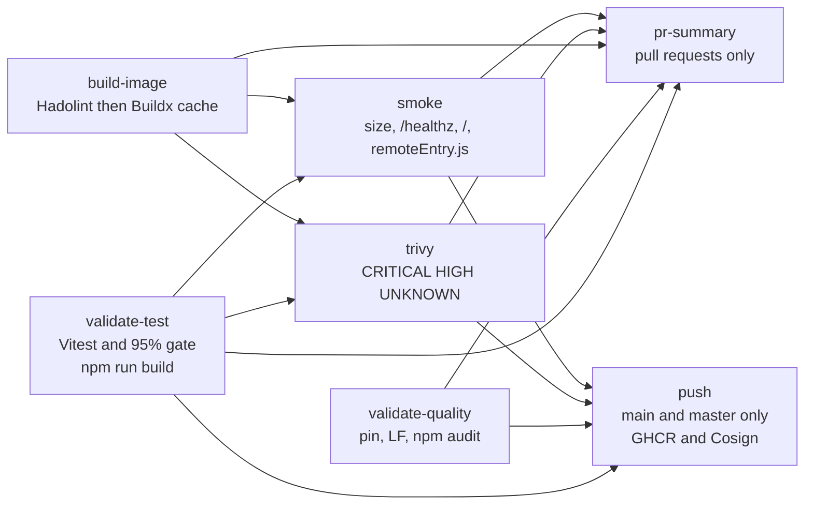
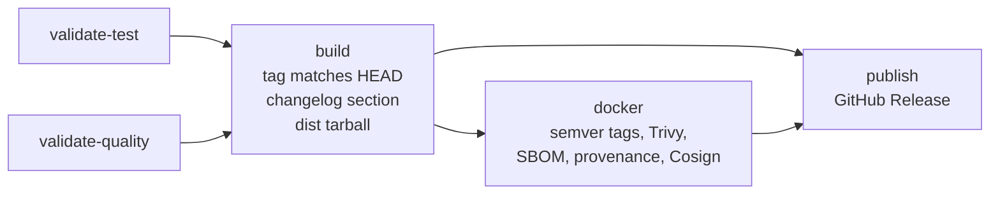

# Pipeline

How GitHub Actions builds, tests, and publishes `web-shell`. Workflows live in [`.github/workflows/`](../../.github/workflows). Scripts they call live in [`.github/scripts/`](../../.github/scripts).

Five workflow files. Markdown-only pushes and pull requests skip `ci.yml` (`paths-ignore: '**.md'`). A commit that also touches code still runs.

| Workflow | When | What it decides |
|---|---|---|
| [`ci.yml`](../../.github/workflows/ci.yml) | Pull request or push to `main` or `master`, or a manual run | Tests, image, scan, smoke. Push to `main` also publishes and signs |
| [`validate-test.yml`](../../.github/workflows/validate-test.yml) | Called by `ci.yml` and `release.yml` | Vitest, the 95% coverage gate, then `npm run build` |
| [`validate-quality.yml`](../../.github/workflows/validate-quality.yml) | Called by `ci.yml` and `release.yml` | Workflow hygiene, digest-pinned `FROM` lines, production `npm audit` |
| [`changelog-check.yml`](../../.github/workflows/changelog-check.yml) | Pull request touching the shell, the lockfile, the Dockerfile, nginx, Vite, federation config, or `index.html` | `CHANGELOG.md` is in the diff |
| [`release.yml`](../../.github/workflows/release.yml) | Tag `vX.Y.Z` or `vX.Y.Z-*`, or a manual run with a tag input | Changelog section, image, SBOM, provenance, GitHub Release |

Dependabot opens pull requests for npm, Docker, and GitHub Actions (`.github/dependabot.yml`).

Node on every job is **22**. `FORCE_JAVASCRIPT_ACTIONS_TO_NODE24` is set so JavaScript actions run on the runner's current Node.

## Pull request and main



Source: [`mermaid/ci-flow.mmd`](mermaid/ci-flow.mmd).

`build-image` does not wait for the test job. Trivy and smoke wait for both the test job and the image. A test failure still skips the scan and the smoke run. `validate-quality` does not block those two. It does block `push`. The summary comment is skipped when any upstream job fails (`if` on the job).

| Job | Gate |
|---|---|
| `validate-test` | `npm ci`, `npm run test:coverage`, [`.github/scripts/coverage-gate.mjs`](../../.github/scripts/coverage-gate.mjs) at 95% for statements, branches, functions, and lines, upload `coverage/`, then `npm run build` (`tsc` and Vite). See [the coverage runbook](../runbook-coverage-gate.md) |
| `validate-quality` | No HTML entities in workflows or scripts. LF in `.github/scripts`, `.github/workflows`, `Dockerfile`, and `nginx/`. Every `FROM` is `image:tag@sha256:…`. `.dockerignore` exists. `npm audit --omit=dev --audit-level=high` |
| `build-image` | Hadolint on `Dockerfile`, then a `linux/amd64` build tagged `web-shell-ci-test` and stored in the Actions cache. Build args: `VITE_KEYCLOAK_URL` and `VITE_APP2_URL` from repository variables, otherwise `http://localhost:8080` and `http://localhost:5002` |
| `trivy` | Reloads that cached image. Fails on unfixed **CRITICAL**, **HIGH**, or **UNKNOWN**. SARIF is uploaded and does not fail the job by itself. CycloneDX SBOM is an artifact named `sbom-<sha>`. Allowlist file: [`.trivyignore`](../../.trivyignore). See [the image runbook](../runbook-image-scan.md) |
| `smoke` | Same cached image. [`.github/scripts/smoke-tests.sh`](../../.github/scripts/smoke-tests.sh): at most 200 MB, `GET /healthz` contains `ok`, `GET /` is 200 and contains `id="app"`, `GET /remoteEntry.js` is 200 |
| `pr-summary` | [`.github/scripts/pr-summary.js`](../../.github/scripts/pr-summary.js) posts one comment. The coverage cell uses the `pct` output of `validate-test` |
| `push` | Push events on `main` or `master` only. Publishes `ghcr.io/bcbp-solutions-fzc-llc/web-shell` with the branch tag and `sha-<short>`, `provenance` and `sbom` on the build, then Cosign keyless sign and verify. The verify identity is `refs/heads/main` or `refs/heads/master` |

Concurrency group `ci-<workflow>-<ref>` cancels an older run on the same ref.

## Release



Source: [`mermaid/release-flow.mmd`](mermaid/release-flow.mmd).

`publish` needs both `build` and `docker`. A failed scan does not open the GitHub Release. Nothing in this workflow deploys a cluster.

The Git tag keeps the `v`. Image tags from `docker/metadata-action` are `X.Y.Z`, `X.Y`, and `X`. `latest` is added when the tag has no `-`. A pre-release tag publishes `X.Y.Z-rc.N` only.

Release Trivy fails on unfixed **CRITICAL** and **HIGH**. It does not include the CI job's **UNKNOWN** severity. Both jobs honor `.trivyignore`.

The GitHub Release attaches `web-shell_<tag>_dist.tar.gz`, `checksums.txt`, `sbom.cyclonedx.json`, and `provenance.slsa.json`. Notes come from the matching `## [X.Y.Z]` section. Steps when a tag fails are in [the release runbook](../runbook-release.md). Maintainer order of work is in [VERSIONING.md](../../VERSIONING.md).

## Changelog check

`changelog-check.yml` is separate from `ci.yml`. It runs on pull requests whose paths include any of:

- `src/**`
- `package.json`, `package-lock.json`
- `Dockerfile`, `nginx/**`
- `vite.config.ts`, `module-federation.config.ts`, `index.html`

The job fails when `CHANGELOG.md` is absent from that diff. A docs-only pull request does not run it. A release tag is checked again by `verify-changelog-entry.sh`, which looks for `## [X.Y.Z]` and does not require the date.

## Local equivalents

```bash
npm run hooks:install   # once per clone; again if .githooks/pre-commit changes
npm run test:ci
npm run build
```

`hooks:install` copies `.githooks/pre-commit` into `.git/hooks`. Each commit then checks staged env files, workflow hygiene, the Dockerfile digest pin, and `tsc --noEmit`. `npm run test:ci` and `npm run build` are the test half of `validate-test`. They do not run Hadolint, Trivy, or the image smoke script. Image checks need Docker:

```bash
docker build -t web-shell:local .
# Hadolint and Trivy are the same tools CI runs; install them locally if you want the same gate before a tag.
```

## Adding a check

| You want | Change |
|---|---|
| A new test | A file under `test/unit`, `test/integration`, or `test/e2e`. The coverage gate already includes `src/**/*.{ts,tsx}` |
| A new workflow file rule | A step in `validate-quality.yml`. Keep the script LF |
| A new image startup URL | `nginx/default.conf` and `.github/scripts/smoke-tests.sh` together |
| A new `VITE_*` value inside the image | A Dockerfile `ARG` and the `build-args` blocks in `ci.yml` (`build-image` and `push`) and `release.yml` (`docker`) |
| A new release asset | `prepare-release-asset.sh` or `create-github-release.sh`, and the artifact upload/download pair in `release.yml` |
